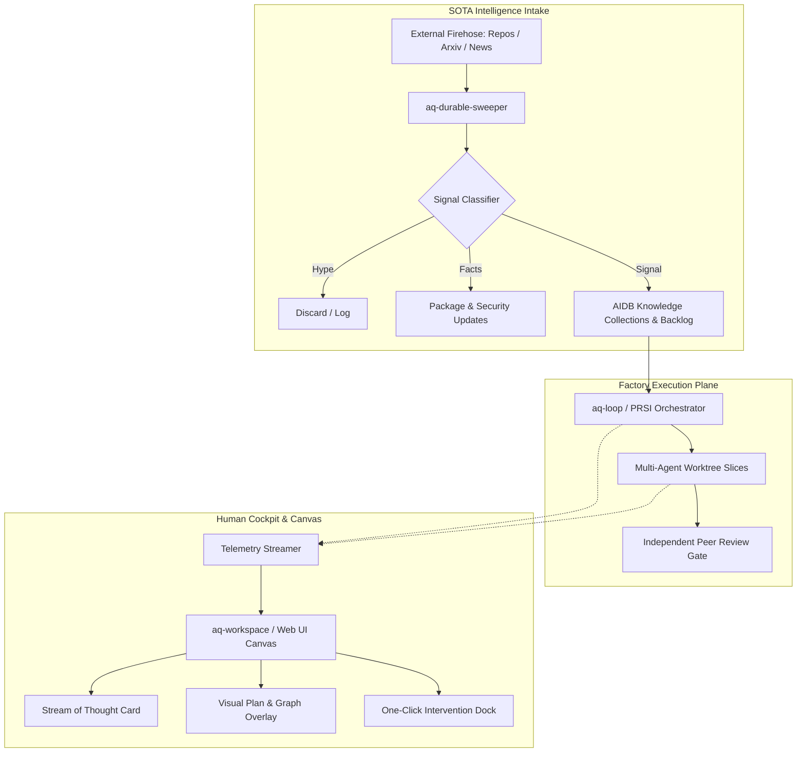

# PRD: SOTA Durable Agent Ecosystem & Next-Gen Human-Agent Interface (AQ-Cockpit / AQ-Canvas)

- **ID**: `PROJECT-DURABLE-AGENTS-SOTA-UI-PRD`
- **Owner**: hyperd (System Owner)
- **Status**: Draft / Proposed
- **Date**: 2026-10-19
- **References**:
  - `https://youtu.be/OLqP8jxJ0Wc` (IndyDevDan / `disler/pi-durable-news-agent`)
  - Canonical Workflow Contract (`.agent/WORKFLOW-CANON.md`)
  - Impeccable Design Intelligence (`.agent/skills/impeccable/SKILL.md`)
  - Understand-Anything Knowledge Graph (`.agent/skills/understand-anything/SKILL.md`)
  - Multi-Agent Workspace (`scripts/ai/aq-workspace`, `config/zellij/aq-agentic-workspace.kdl`)

---

## 1. Executive Summary & Vision

The cutting edge of agentic software engineering is shifting rapidly along two primary axes:
1. **Durable, Proactive Background Autonomous Loops**: Moving beyond ephemeral, reactive chat loops to durable agents that execute scheduled sweeps, filter the global firehose (Hype vs. Facts vs. Signal), checkpoint state safely, and surface high-signal development intelligence autonomously.
2. **High-Clarity, Human-Centric Agentic Interfaces (SOTA UI/UX)**: Moving beyond dense walls of raw terminal logs to intuitive, multi-modal cockpits featuring live stream-of-thought cards, intervention docks, artifact carousels, and interactive visual flowcharts/graphs (inspired by platforms like Cursor, Windsurf, Claude Artifacts, and v0/shadcn).

This PRD formalizes the architecture, requirements, and rollout plan to implement both capabilities into **NixOS-Dev-Quick-Deploy (AQ-OS)**.

---

## 2. Core Themes & Requirements

### Theme 1: Durable Autonomous Agent Engine (`aq-durable-agent`)
- **Inspiration**: `pi-durable-news-agent` (IndyDevDan).
- **Durable Scheduling & State Preservation**:
  - Integrate with systemd timers and local Redis/Postgres persistence to checkpoint execution frames.
  - If a loop is interrupted by system rebuilds or reboots, it resumes from the latest checkpoint without lost state.
- **Signal-to-Noise Classifier (Hype vs. Facts vs. Signal)**:
  - Sweeps frontier releases, GitHub trending, arxiv AI papers, and Nixpkgs upstream updates.
  - Automatically evaluates incoming intelligence:
    - **Hype**: Marketing claims without code, benchmarks, or reproducible receipts.
    - **Facts**: Verified releases, CVE fixes, upstream package updates.
    - **Signal**: Breakthrough architecture patterns, SOTA agent skills, tooling improvements directly applicable to our local software factory.
- **Closed-Loop Knowledge Ingestion**:
  - High-signal findings automatically seed local AIDB RAG (`skills-patterns`, `best-practices`, `error-solutions`).

---

### Theme 2: Next-Gen Human-Agent Interface (`aq-cockpit` / Web Canvas)
- **Inspiration**: Impeccable OKLCH typography/motion principles, Claude Artifacts, Windsurf Flow, and Zellij interactive consoles.
- **Problem Statement**:
  - Operators need to see what agents are thinking in real-time, inspect diffs, and easily intervene without squinting at scrolling console buffers or dealing with empty, stalled panes.
- **Components**:
  1. **Thought & Intent Stream**:
     - Dedicated card displaying current step, live thinking summary, tool call arguments, and execution elapsed time.
  2. **One-Click Human Intervention Dock**:
     - Explicit states: `OBSERVING`, `AWAITING_INPUT`, `INTERVENTION_REQUESTED`, `ERROR_PAUSED`.
     - Direct text injection or single-key steering (`[p] Pause`, `[r] Resume`, `[s] Skip step`, `[e] Edit intent`).
  3. **Visual Plan & Knowledge Graph Overlay**:
     - Embedded Understand-Anything graph view showing active blast radius and file dependencies before changes land.
  4. **Artifact & Diff Preview Canvas**:
     - Live side-by-side rich diff view of candidate worktree changes before commit/PR creation.

---

## 3. Architecture & System Flow

---

## 4. Multi-Agent Team Execution Plan

| Phase | Milestone | Primary Lane | Supporting Lanes | Acceptance Criteria |
|---|---|---|---|---|
| **Phase 1** | **Durable Agent Architecture** | Claude (Sonnet) | Antigravity, Codex | Durable checkpoint runner, state save/restore tests, Hype/Fact/Signal classification schema. |
| **Phase 2** | **Frontier Sweeper & AIDB Integration** | Antigravity / Gemini | Local Qwen, Codex | Scheduled runner under `aq-confine`, automated seeding of high-signal items into AIDB RAG. |
| **Phase 3** | **Cockpit UI & Stream-of-Thought Interface** | Claude (Sonnet) | Antigravity | Impeccable design standards, live WebSocket stream of thought, zero empty panes. |
| **Phase 4** | **Interactive Steering & Visual Artifact Canvas** | Antigravity | Codex | Intervention modal, visual diff preview, live blast-radius inspection. |

---

## 5. Definition of Done & Activation Guard

No phase is complete until:
1. Declaratively configured in NixOS modules (`nix/modules/services/` or `home-manager`).
2. Confined via `aq-confine` for any external scraping or untrusted input.
3. Live tested against real agent runs with verifiable log proofs in `PULSE.log`.
4. Visual components adhere to the `.agent/skills/impeccable/SKILL.md` design standards (contrast, a11y, responsive layout, dark-mode elegance).
