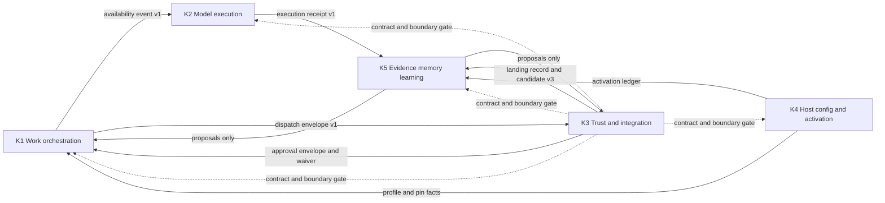

# PRD: Control-plane consolidation (bounded contexts, contracts, single-owner guards, adopt-vs-build)

Status: DRAFT rev 5 (2026-11-27), pending buy-in. Rev 5 AMENDS rev 4 in place on this branch (no second plan) and ships with S1 code (no docs-only PR). Sections changed or added in rev 5 are marked "(rev5)"; everything else is rev 4 text that is still valid. Rev 4 owner-freeze, independent confirmation and its `PLAN_READY_WITH_FOLLOWUPS` state do not carry over: S0 re-freezes rev 5 against the exact DESIGN.md and tracker.json. Author lanes: Claude (rev 1–3, rev 5 consolidation), Codex (rev 4 continuation); rev 5 consolidates three independent drafts (Claude, Codex, Gemini), see `REVIEW-R5.md`.
Tracker: `tracker.json` in this directory.
Review record: `.agents/plans/control-plane-consolidation-r1/` (`codex.md`, `gemini.md`, `README.md`). The round-two records are in `.agents/plans/control-plane-consolidation-r2/`. Dispositions are recorded below.
Origin: owner-trusted external review of 2026-11-22 (`.agents/delegation/outputs/external-review-20261122/INPUT.md`) plus the owner ask "how do we best incorporate this feedback into our designs, implementation, past and future work". Inputs: `CENSUS-summary.md`, `codex-critique.md`, `gemini-synthesis.md`, `adopt-vs-build-20261122-gemini.md`, `COORDINATION.md`.
Rev5 record (rev5): `REVIEW-R5.md` (input drafts with sha256, disagreement table, delta-review corrections, open questions, buy-in table). One-page external summary: `ARCHITECTURE-SUMMARY.md` (moves to `docs/architecture/ARCHITECTURE-SUMMARY.md` with S1). Rev5 evidence: Phase 0 files `delta.md`, `census-refresh.md`, `candidates.md`, `c1-c4-audit.md`, `upstream-candidates.md`, `review-codex.out`, `review-gemini.out` under `.agents/delegation/outputs/arch-consolidation-rev5/` (cited below as `P0/<file>`; S1 copies them into `docs/harness-first/evidence/2026-11-27-arch-rev5-phase0/` because the outputs directory is not tracked). Evidence tags: [V] verified in this consolidation by reading the cited file at the rev 4 base commit `af2a99023` (pre-rebase) AND re-reading it against `origin/main` `3be232b6c` on 2026-11-27 (the two agree for every [V] fact in this document; a claim about `origin/main` that was not re-read is [C]); [C] carried from a Phase 0 file or a lane draft and not re-run; UNVERIFIED = no primary source checked. The plan branch base `af2a99023` is 49 commits behind `origin/main` (`git rev-list --count HEAD..origin/main`); the S1 code PR rebases first.
Umbrella over (no duplicate plans): single-owner-guards-20261119, aq-update-unified-20261119, agent-work-durability-20261119 (already designed; reused, not re-specified), and experience-capture-20261119 (not bundled as frozen; its two open REVISE verdicts must be re-checked against the PRD merged in #878, see the S10 entry condition (rev5)). single-owner-guards and aq-update-unified live only in worktrees and are not on main; S1 lands them with the first code.

## Rev5 amendment summary (rev5)

Why: rev 4 diagnosed ownership-in-prose and designed the fixes, but none are enforced (this branch is not on `main`; `git log --since=2026-11-23 origin/main -- config/system-state-authorities.yaml contracts crates` is empty [C `docs/harness-first/evidence/2026-11-27-arch-rev5-phase0/census-refresh.md:24`]) while new writers landed on `main` (`scripts/ai/lib/work_ledger.py` #882, `aq-land:82` reading `config/model-coordinator.json` #860, lane-registry reads #874; an uncommitted `aq-land-queue`) [C `docs/harness-first/evidence/2026-11-27-arch-rev5-phase0/census-refresh.md` section 1-2]. The owner brief adds hard constraints C1-C5, a contract guard, an upstream register, ADRs, a summary, and approved decisions D-R5-1..6.

What rev5 adds to rev 4 (K1-K5, A1-A9, DO-1..DO-7, the S2/S1b admission contract, the MVP order and all verified claims stay):
1. A 28-row decision taxonomy with computed overlap/orphan ranges, not a 0/0 claim (section "Decision ownership matrix").
2. A Rust contract guard in S1 over the five call kinds, driven from the one existing registry, with anti-weakening tests (D-R5-3).
3. C1-C5 as checks on a defined SUPPORTED INSTALL, with a remote-lanes add-on outside it (D-R5-2), C3 pin and C5 licence policies.
4. Owner-waived local-only landing (D-R5-1), `aq-land-queue` as the sole queue after S2 (D-R5-4), the `lite` profile (D-R5-6), offline journeys J6-J8 and an offline install runbook.
5. Upstream register `scripts/upstream/REGISTER.json` (new) (D-R5-5), ADRs, the one-page summary.
6. New slices S1c, S1d, S4a, S13 (MVP) beside rev 4's S-numbers; execution order updated.

Binding owner decisions of 2026-11-27 (approved; design to them, not open questions):

| Id | Decision | Where designed |
|---|---|---|
| D-R5-1 | Explicit local-only landing mode: owner waiver bound to exact candidate, policy revision, scope and expiry; records the assurance deficit; never a review receipt; never automatic during remote outages; local checks stay independently executable | "Local-only landing" |
| D-R5-2 | C2 as written for the SUPPORTED install: Node-free closure at build AND runtime; `LLAMA_BUILD_UI=OFF`; gate/replace `npx` launchers; retire `nix/pkgs/{pi-agent,continue-cli}.nix`; Codex/Gemini/Qwen CLIs become an optional "remote lanes" add-on outside the supported install | "C1-C5 policies", S1d |
| D-R5-3 | Contract guard in S1: extend Rust `crates/contract-validator` with a `contracts` check and an import-boundary rule, driven from `config/system-state-authorities.yaml`; `CONFIG_SCHEMA_REGISTRY` derived or an explicit schema lookup; fail-closed; negative tests prove a candidate cannot weaken its own checker; covers HTTP, subprocess, event and dynamic calls | "Contract design and the Rust contract guard" |
| D-R5-4 | `aq-land-queue` is the sole queue as S1b, activated only after S2's admission verifier; ad-hoc `seqland*` scripts retired in the same PR | S1b |
| D-R5-5 | Upstream register at `scripts/upstream/REGISTER.json` (new), versioned schema under `contracts/`; defined direction vs `.agent/WORKAROUND-REGISTER.md`; owner-only extraction/submission; guard against AI attribution trailers in upstream-bound commits | "Upstream workstream" |
| D-R5-6 | `lite` profile with explicit resource and usability budgets measured on a 16 GB machine; `ai-dev` hard `= true` daemon flags to `mkDefault`; tiered RAM assertion; Postgres/Qdrant/merge-queue off in `lite` without dropping needed authn/authz | "`lite` profile" |

Corrections from the two independent Phase 0 delta reviews are applied throughout and listed in `REVIEW-R5.md`. Counts: the delta's "9 overlaps / 3 orphans" is a floor on a different decomposition, not a measured total; this document reports ranges and refuses to print 0/0 until a tool computes it.

## Problem

The reviewer said the number of control planes is high and that overlapping responsibilities make it hard to say which component owns a decision. The census confirms it: about 30 components decide things, and nine decisions have more than one owner.

| # | Decision | Owners today (evidence) | Cost observed 2026-11-19..22 |
|---|---|---|---|
| 1 | Model routing | `config/model-coordinator.json` is opened by the coordinator, `aq-role-route`, `delegate-to-claude` (and referenced by `aq-model-eval`, `scripts/ai/lib/gemini-model-guard.sh`, `scripts/ai/lib/brief_caps.py`, `scripts/governance/sweep-lanes.py`; the S3 inventory separates opens from mere references). `scripts/ai/lib/model_tiering.py` defines `MODEL_COORDINATOR` but does NOT read it: it hardcodes `_LANE_MODEL_KEYS` and `_CLAUDE_MODEL_FOR_COMPLEXITY` (`:28,38-49`), as does `aq-role-route:84-105`. The switchboard keeps its own profile catalog (`ai-stack/switchboard/switchboard.py:461`) | Parallel sources of model identity; a config edit has no single consumer to test |
| 2 | Lane availability and eligibility | wrapper cooldown files, `lane-eligibility-registry.json`, `aq-role-route`, `aq-land` reviewer choice each decide separately | Backlog LANE-AVAILABILITY-NOT-PER-MODEL: a cooldown on one model marked the whole lane down |
| 3 | PR branch mutation | `aq-land`, two ad-hoc land runners, Dependabot, Gemini all write PR branches | Five mutators. LAND-RUNNER-NOT-DURABLE; DEPENDABOT-REBASE-NOOP-AFTER-FOREIGN-PUSH (Dependabot refuses a rebase once anyone else pushed) |
| 4 | Review independence | `aq-land:396-403` and `aq-review-receipt:118,181` compare the declared `Author-lane`; receipt validation also accepts an earlier head after a clean main-only merge (`aq-land:386-413`) | Backlog AUTHOR-LANE-TAG-NOT-COMMIT-AUTHOR: the tag can say "gemini" while Claude wrote the commits; related to the fabricated-review-claims audit (about 85 PRs, 48 self-acceptances) |
| 5 | Health, QA and remediation | health-spider, health-monitor, `aq-qa`, coordinator `qa_check`, oncalld, `aq-alerts`, dashboard; four also remediate: auto-remediate, gap-auto-remediate, the health-spider fix pipeline, oncalld | Backlog EMBEDDER-STICKY-DEVICE-LOST records false-green health and missed recovery. Overlapping remediation authority is a separate risk documented in the ownership inventory. |
| 6 | Loops | `aq-loop`, ralph-wiggum, `aq-agent-loop`, autonomous-improvement, PRSI, `aq-collab-round`: six queues and retry policies | Rule 6 retry budget enforced six ways |
| 7 | Deploy | `aq-update`, `aq-deploy-current`, `nrs`/`nrb`/`nrd` (no guards), `system-update-full.sh`, `aq-update-tiers` | Nine entry points; a rebuild nearly ran on a 6-day-stale lock |
| 8 | Memory | coordinator store/recall, `aq-memory`, AIDB, Qdrant, agent memory files | Writers without one API |
| 9 | Learning | `continuous_learning_daemon`, meta-optimization, `aq-local-training-loop`, federated learning, lesson tools | No single lesson/proposal schema |

Root cause (Rule 19): ownership lives in prose and per-PRD lists. `config/system-state-authorities.yaml` already records one authority per state, but all ten rows are `SPLIT_BRAIN` with expired resolution deadlines (all dated 2026-10-09), and its checker does not yet fail on a NEW competing writer. The remedy (bounded contexts plus contracts) is right; the missing half is enforcement on the registry we already have.

Verified at drafting time (primary sources, see the claim table): the ten ledger rows; `aq-land:396`; the dispatch envelope, QA probe schema, memory registry and state-authorities checker exist. Not found: any file at the schema path `config/model-coordinator.json:7` points to (`./schemas/model-coordinator-schema.json`, a dangling reference). The five backlog IDs were verified against the primary backlog (see the claim table).

### Problem addendum (rev5)

Six measured gaps against the owner brief. Each [V] item was read at the base commit and re-read against `origin/main` `3be232b6c`; items tagged [C] were not re-read:

1. No measured ownership matrix. Rev 4 counts nine multi-owner decisions and never counts orphans. The ledger has 10 rows and the census 9 decisions: different sets. Three documented recovery orphans exist: `config/system-state-authorities.yaml:186` (`intent-resume` PENDING recovery UNOWNED), `:232-242` (`workflow-run-task` checkpoints UNKNOWN), `:501` (`dashboard-operator` approval recovery UNOWNED) [V by both Phase 0 reviewers, `.agents/delegation/outputs/arch-consolidation-rev5/review-codex.out`, `.agents/delegation/outputs/arch-consolidation-rev5/review-gemini.out`].
2. `contracts/` holds two Python packages only: `contracts/events/envelope.py` and `contracts/config/{__init__,switchboard_profiles}.py` [V `ls contracts`]. `crates/contract-validator` has `main.rs` and `scope_gate.rs`; its subcommands are `all|writable-state|memory-surface|scope-gate` [V `main.rs:71-74`]; `tier0.d/check-owned-scope.sh:11-14` exits 0 whenever `OWNED_PATHS` is unset [V]. It validates no `contracts/` schema and no import edge. `config/schemas/` holds 64 tracked files [V `git ls-files config/schemas`] (the delta said 59; 71 `*.schema.json` repo-wide [C]).
3. `check-state-authorities.py` is wired into `config/ci-checks.json` (lines 2125 and 2237), `config/validation-check-registry.json:1044`, `scripts/ai/_aq-qa-bash:1676` and `scripts/testing/harness_qa/phases/phase0.py:3057` [C `.agents/delegation/outputs/arch-consolidation-rev5/review-gemini.out`], but into neither `tier0-validation-gate.sh` nor a `.github/workflows` job [V at branch head: `rg -l state-authorities scripts/governance .github` returns only the checker itself; origin/main per `.agents/delegation/outputs/arch-consolidation-rev5/review-gemini.out`].
4. Hard constraints C1-C5 (below) are unstated in rev 4 and the tree violates C2 widely: `nodejs` in all four profile lists [V `nix/data/profile-system-packages.nix` (lines 7, 96, 112, 128)], npm CLIs, `buildNpmPackage`, `npx` launchers, llama.cpp web-UI `npmDeps` [C `docs/harness-first/evidence/2026-11-27-arch-rev5-phase0/c1-c4-audit.md`]. C1 is partly violated: `config/model-coordinator.json:480` defaults reasoning to `claude-reasoning` [V], and `aq-land` refuses local review of trust-critical paths (`aq-land:56,407,636-637` [C]).
5. C4: the AI stack asserts >= 12 GB (`nix/modules/roles/ai-stack.nix:1010` [V]); `minimal` turns the stack OFF; `ai-dev.nix:54-71` sets daemons `= true` without `mkDefault` [V]; no student-capable profile exists (profiles are ai-dev, aqos-workstation, gaming, minimal [C]).
6. No upstream register and no ADR directory (`docs/architecture/adr` absent [V]); `scripts/upstream/track` and `dev` are files, so a register under a `track/` directory is impossible and the register is `scripts/upstream/REGISTER.json` (new) [V `ls scripts/upstream`]; `.upstream/` is already gitignored at `.gitignore:167` [V].

Root cause (Rule 19): the guard rev 4 chose protects writers of state, not call shapes or import edges, and is wired into no required gate. Fix the producer: a fail-closed checker driven from the one existing registry, extended to the call kinds the brief names.

## Goals

1. Five bounded contexts (K1-K5) over nine aggregates (A1-A9); each aggregate has one owner, owned decisions, a published contract that is actually active, consumers and an enforcement check with a negative test.
2. Enforcement on the EXISTING registry (`config/system-state-authorities.yaml` and `scripts/governance/check-state-authorities.py`), no second registry.
3. An adopt-vs-build decision per context with explicit criteria and "replace, never run both" (with a sunset for any spike).
4. In-flight plans fold in as slices; no duplicate plans.
5. Future PRDs carry a three-line header: bounded context + owner, contract, build-vs-adopt check.
6. (rev5) One decision-ownership matrix (writer, admission, readers, projections) whose overlap and orphan counts are computed by a tool, never typed.
7. (rev5) Every cross-context call (import, subprocess, HTTP, event, dynamic) goes through a versioned contract under `contracts/`, enforced by the Rust `crates/contract-validator` in tier0 and a trusted required CI check.
8. (rev5) C1-C5 are checks on a defined supported install; offline journeys J6-J8 (inference, review, governance) run with no hosted credentials; `lite` runs on a 16 GB machine within measured budgets.
9. (rev5) An ADR per adopt/build decision, a one-page architecture summary, and an upstream register with owner-only extraction and submission.

## Non-goals

- A big-bang rewrite. Each context converges by slices behind its contract; today's tree must pass every new check on day one (regression-only enforcement, dated exceptions).
- Adopting any external framework in the MVP. Current components are kept (D4).
- New services, daemons or state stores. If an evidence reducer needs a host it lives in an existing process; a new daemon or store is a scope decision for the owner.
- New canon instruction lines beyond single-owner-guards R4's zero-net budget; UI/UX styling (Rule 23 exemption).
- (rev5) Removing the owner's Claude/Codex/Gemini lanes: they move to an optional remote-lanes add-on outside the supported install. Not a legal opinion on licences (the owner confirms D12). Not a sixth context, a new registry, or a new queue service.
- (rev5) Whole-roadmap zero overlap/orphan at MVP exit: S12 claims zero only for MVP-scope rows and reports the post-MVP rows separately.

## Design

### Principle
A context is a boundary of decision ownership, not a service. Cross-context interaction goes through a published, ACTIVE schema; a consumer never reads another context's private state (files, cooldown dirs, queues). Complexity lives in the aggregate; each piece stays simple (Rule 20b).

### One map: five contexts (K1-K5) over nine aggregates (A1-A9)
The target map is the five contexts (derived from the kernel declaration and the ten ledger rows; Codex and Gemini converged on it, the census's 8-9 mirrored current tool boundaries). The census contexts are kept as aggregates, each nested in exactly one context. A9 (approval and authority) is COUNTED, not optional: operator grants need a mandatory owner.

| Context | Aggregates | Ledger rows | Single owner per decision |
|---|---|---|---|
| K1 Work orchestration | A2 dispatch, delegation, lane availability and eligibility; loops are callers | `planning-round`, `delegation-lifecycle`, `intent-resume`, `workflow-run-task` | coordinator (round store, task registry, intent interface, run store); `aq-event` append path; `RESUME.json`/`PULSE.log` are projections |
| K2 Model execution | A1 routing | `routing-model-execution` | coordinator owns route SELECTION and POLICY INTERPRETATION and issues the resolved run plan; switchboard owns EXECUTION against an accepted plan and returns the execution receipt. Neither owns the other's half |
| K3 Trust and integration | A3 review, A4 landing, A9 approval | `dashboard-operator` | operator grants: coordinator approval store is the sole writer; independence verdict: `aq-review-receipt`; protected-branch admission: `aq-land` |
| K4 Host configuration and activation | A5 deploy | `configuration` | evaluated Nix options own configuration; `aq-update` owns the activation decision and ledger |
| K5 Evidence, memory and learning | A6 memory, A7 observability and QA, A8 learning (separate aggregates, one owner each) | `qa-effectiveness`, `learning-eval`, `memory-rag` | evidence reducer; coordinator evaluation ledger; MemoryBroker (Qdrant is a derived index). Learning and evidence EMIT proposals and requests; the context that owns a decision issues the authoritative command |

How K1 feeds K2: K1 publishes a per-(lane, model) availability and eligibility event; K2 consumes it when it resolves a plan. K2 never reads wrapper cooldown files.

#### Context refinements and glossary (rev5)

K1-K5 and A1-A9 are unchanged: no sixth context is justified, because every new decision type fits an existing owner and a sixth would repeat the census mistake (its 8-9 contexts mirrored tool boundaries). Three content changes, each closing an ownerless decision in the matrix below:

- K3 gains CONTRACT AND GATE GOVERNANCE (contract-version compatibility, CI/tier0 gate and exception ownership) and the local-only waiver; the Rust `harness-contracts` binary is its verdict source. No runtime service is added.
- K4 gains SECRETS/SOPS PROVISIONING and the THIRD-PARTY PIN AND UPSTREAM LIFECYCLE (`scripts/upstream/REGISTER.json` (new)). Owner-only extraction and submission remain owner acts recorded in the register.
- K1 gains RECOVERY of PENDING intent and workflow checkpoints; K3 gains approval recovery. These three ledger rows are `UNOWNED/UNKNOWN` today; the coordinator already owns the stores (rev 4 K1 and K3 owner cells), so the recovery decisions go to the coordinator and nothing new is built to own them.

| Term | Meaning |
|---|---|
| Dispatch | An admitted unit of work. Availability is per (lane, model), never per lane. |
| Operation | One external mutation with a unique id and the states `RESERVED`, `APPLIED`, `HELD`, `VOID`. |
| Candidate | (numeric repo id and PR for GitHub mode, local repo identity for local-no-github mode, target ref, base, head, tree, provenance and author-set digests, policy revision): the rev 4 candidate v3. |
| Waiver | An owner-issued, candidate-bound, expiring record of accepted assurance loss. Never a review receipt. |
| Gate | A check whose result binds admission (tier0 check, required CI check, runtime admission). |
| Profile | An install shape (`lite`, `ai-dev`). Supported install = a profile closure with the remote-lanes add-on OFF. |
| Projection | A derived view with no write authority (`RESUME.json`, `PULSE.log`, dashboards, `aq_baseline` output, Qdrant). |

### Context map (rev5)

Relationships. K1 is upstream of K2 (customer-supplier; K2 conforms to K1's availability schema; K2 never reads wrapper cooldown files). K3 is the published-language provider for approvals, waivers and candidates. K5 is a conformist consumer that never commands: learning and evidence emit proposals, the owning context issues the command. Dotted edges are the guard (a build and CI check), not a runtime call. `contracts/` plus `config/system-state-authorities.yaml` are a specification and validation dependency, not a runtime context. [Mermaid source: Claude draft section 4; contracts-node framing: Codex draft section 4.]

### Aggregates

| # | Aggregate | Single owner | Published ACTIVE contract | Notes on stale contracts (r1) |
|---|---|---|---|---|
| A1 | Routing | coordinator (selection, policy, resolved plan); switchboard executes | `config/model-coordinator.json` + NEW `config/schemas/model-coordinator-schema.json` (the filename already referenced at `model-coordinator.json:7`) + `ResolvedRunPlan` v1 (execution profile, authentication class, fallback policy) + execution receipt | S3 writes the schema and `ResolvedRunPlan`; credentials stay in the execution lane |
| A2 | Dispatch, delegation, availability | delegation registry + `lane-eligibility-registry.json`; `delegate-*` are thin executors | `agent-dispatch-envelope.schema.json` (active, includes `gemini`) + availability event keyed `(lane, model)` | `delegation-task-record.schema.json` is INACTIVE (M2B not authorized, lane enum lists `antigravity`, omits `gemini`): NOT used as a contract unless S4 includes its authorization and enum update. (rev5) #871 renewed 23 of 25 grants to 2027-01-09 and revoked Gemini orchestrator and binding-acceptance: see D11 |
| A3 | Review and trust | `aq-review-receipt` | review receipt schema-2 (exact head + tree, reviewer lane); v3 adds authenticated reviewer identity and candidate binding | existing schema-2 receipts stay verifiable (backward compatible) |
| A4 | Integration / landing | `aq-land` | landing record + branch-mutation lock; the durable runner is `aq-land-runner.service` from agent-work-durability (no second runner) | |
| A5 | Deploy | `aq-update` (`aq-deploy-current` becomes its stage) | aq-update ledger (aq-update-unified) | |
| A6 | Memory | MemoryBroker; coordinator memory API is the facade | `config/agent-memory-surface-registry.json` (made normative) | |
| A7 | Observability and QA | one health pipeline, one remediator (provisional, see D8) | `qa-provider-probe-contract.schema.json` + NEW health sample/verdict schema | the probe schema omits `gemini` (`:13`); S6 adds it |
| A8 | Learning | continuous-learning + PRSI | `learning-candidate.schema.json` + lesson/proposal schema | depends on the experience-capture revision (S10) |
| A9 | Approval and authority | coordinator approval store (operator grants); identity-kernel | approval envelope + `capability-lease.schema.json` | The lease schema describes report-only checks. Switchboard implements per-tool enforcement and its Nix service declares it enabled. Live enforcement remains unverified. S2 reserves operator grants at queue admission. |

Loops (ralph-wiggum, `aq-loop`, `aq-agent-loop`, autonomous-improvement, `aq-collab-round`) are consumers of A2/A3/A4, not a context; their retry policies converge on A2's budget (S8).

#### Aggregate amendments (rev5)

- A2: adds the recovery owners for PENDING intent and workflow checkpoints (coordinator intent interface and run store, S4a). The reservation/retry/reconciliation of external operations stays one protocol (S2) that the sole queue executes (S1b).
- A4: `aq-land-queue` is the sole queue implementation, run by the existing durable `aq-land-runner.service` (one queue, one unit); the `seqland*` scripts retire in the S1b PR. It is not merged or activated ahead of S2: merged earlier it would be a dormant second writer (Rule 23) with local JSON state and no reservation, fencing or remote reconciliation [C `docs/harness-first/evidence/2026-11-27-arch-rev5-phase0/census-refresh.md` section 2].
- A9: gains the local-only waiver (coordinator approval store, candidate-bound) and the approval-recovery owner (coordinator, from the reservation log). Lease, execution-cell and revocation-epoch authority stay with the identity-kernel chain; runtime per-tool enforcement stays UNVERIFIED (rev 4 claim row) and is listed as unverified row D21 below.
- A5: gains secrets/SOPS provisioning and the upstream register. `lite` and the supported-install boundary are A5 configuration, not a new aggregate.

### Decision ownership matrix (rev5)

Taxonomy. W = authoritative writer; A = admission (the point that accepts or refuses the write); R = reader; P = projection. A decision has exactly one W and one A at target. Readers and projections (a shared registry read, a metric, `RESUME.json`, a Qdrant replica of a fenced authority) never count as competing writers. Counting rule: the writer total = sum over decisions of max(0, active independent writers - 1) (the number of overlapping ROWS is a separate metric, reported next to it, never in its place); orphan = a decision with no declared, implemented and reachable owner, or a recovery owner `UNOWNED/UNKNOWN`. Recovery decisions count separately from the decisions they recover.

Method. The 28 rows are a SEED, drawn from the Claude draft (which unions rev 4's nine census decisions, the ten ledger rows, the three recovery orphans, and the decision types both Phase 0 reviewers listed as missing). S1 prints the counts from `config/system-state-authorities.yaml` with `contracts decisions --count` (a Python prototype, `check-state-authorities.py --matrix`, until the Rust output matches), and ships a mapping from rev 4's rows and from the other drafts' decompositions (Gemini's 19 rows, Codex's 29) to these D-ids. Tags: OV = overlap verified in a primary source this session by a lane; OVc = overlap carried from rev 4 or the census, not re-audited; OR = orphan verified; UQ = unverified; NEW = new decision; OK = single owner today.

| ID | Decision | Today (W / A) | Target owner and disposition | Slice | Tag |
|---|---|---|---|---|---|
| D01 | Route selection and policy | coordinator; `aq-role-route:84-105`; `delegate-to-claude:48`; `model_tiering.py:28,38-49` hardcodes; switchboard catalog `switchboard.py:461`; `aq-land:82` | coordinator; others read the route-policy module (merge) | S3 | OV |
| D02 | Execution against an accepted plan | switchboard | keep (thin adapter) | - | OK |
| D03 | Per-model availability | wrapper cooldown files; `lane-eligibility-registry.json`; `aq-role-route`; `aq-land` | coordinator API keyed (lane, model); cooldown reads retired | S4 | OV |
| D04 | Lane eligibility grants | `lane-eligibility-registry.json` (`aq-land` reads, #874) | keep; readers only | - | OK |
| D05 | PR branch mutation | `aq-land`; `aq-land-queue` (uncommitted); `seqland*.sh`; Dependabot; Gemini | `aq-land` through the sole queue (S1b); bots request, never push directly (S7) | S1b, S7 | OV |
| D06 | Independence verdict | `aq-land:396-403`; `aq-review-receipt:118,181`; `check-review-disposition.py` | one protected verifier (S2) | S2 | OV |
| D07 | Protected-merge admission | `aq-land` plus GitHub required check | merge-queue group check plus `aq-land` preflight (S2) | S2 | OK |
| D08 | Approval issuance and revocation | coordinator approval store | keep | - | OK |
| D09 | Approval recovery | UNOWNED (`system-state-authorities.yaml:501`) | coordinator, from the reservation log | S4a | OR |
| D10 | PENDING intent recovery | UNOWNED (`:186`) | coordinator intent interface | S4a | OR |
| D11 | Workflow checkpoint recovery | UNKNOWN, unwired (`:232-242`) | coordinator run store; wire or retire the checkpointer | S4a | OR |
| D12 | External-op reservation, retry, reconciliation | `aq-land` retry; `aq-land-queue` state; `work_ledger.py` | coordinator reservation protocol (S2); the queue executes | S2, S1b | UQ |
| D13 | Health verdict | health-spider; health-monitor; `aq-qa`; `qa_check`; oncalld; dashboard | one pipeline | S6 | OV |
| D14 | Remediation execution | auto-remediate; gap-auto-remediate; health-spider fix pipeline; oncalld (repairs OFF) | one remediator, chosen in S6 from measured behaviour | S6 | OV |
| D15 | Loop retry budget | six loop families | A2 budget | S8 | OVc |
| D16 | Deploy activation | `aq-update`; `aq-deploy-current`; `nrs/nrb/nrd`; `system-update-full.sh` | `aq-update` | S5 | OVc |
| D17 | Host configuration | evaluated Nix options | keep | - | OK |
| D18 | Memory writes | coordinator; `aq-memory`; AIDB; Qdrant; files | MemoryBroker facade | S11 | OVc |
| D19 | Learning proposals | `continuous_learning_daemon`; meta-opt; local-training; federated; `aq_baseline.py` is a projection | one proposal schema | S10 | OVc |
| D20 | Delegation lifecycle record | delegation registry plus `work_ledger.py` (#882) | work ledger = event log, registry = projection | S1b | UQ |
| D21 | Lease, execution cell, revocation epoch | identity-kernel chain (`ai-dev.nix:54-71`); switchboard evaluator | identity-kernel (W); switchboard and cell runner (A); runtime enforcement probed in S13, enabled in S13b if found off | S13, S13b | UQ |
| D22 | Secrets/SOPS provisioning | SOPS files and modules | K4 declarative module; `lite` local bootstrap (no remote keys) | S13 | UQ |
| D23 | Contract-version compatibility | none ([V] the validator checks no contracts) | contract guard (K3) | S1 | OR |
| D24 | CI/tier0 gate and exception ownership | `config/ci-checks.json`; `config/validation-check-registry.json`; `tier0.d`; `.grype.yaml`; `WORKAROUND-REGISTER.md` | gate list and exceptions in the registry YAML with owner and expiry | S1 | OV |
| D25 | Upstream extraction/removal lifecycle | `WORKAROUND-REGISTER.md`; `.upstream/` (ignored) | `scripts/upstream/REGISTER.json` (new) (K4) | S1c | OR |
| D26 | Paid-API and Node/npm exception policy | none | contract guard (K3); allowlist in the registry YAML | S1d | OR |
| D27 | Intent-lock and session continuity | `RESUME.json`; `PULSE.log`; coordinator | coordinator; the files are projections | S4a | UQ |
| D28 | Local-only landing waiver | none (`aq-land` refuses) | coordinator approval store, candidate-bound | S2 | NEW |

Current counts over the 28 seed rows: verified overlap 7 (D01 D03 D05 D06 D13 D14 D24); carried overlap 4 (D15 D16 D18 D19); verified orphan 6 (D09 D10 D11 D23 D25 D26); unverified 5 (D12 D20 D21 D22 D27); new 1 (D28); single-owner 5 (D02 D04 D07 D08 D17). Reported as two separate metrics. Overlapping rows (counts ROWS): 7 verified, 4 carried and 5 unverified. Writer total (the defined metric): UNKNOWN until every row has a verified writer list (17 rows lack one at S1), with no upper bound claimed; `harness-contracts decisions --count` prints it as unknown beside a verified lower bound and drops the former "up to 16". Orphans: at least 6 verified (D28 and the five unverified rows could add up to 6), total unknown until the tool counts. Not 0/0, and not rev 4's 9/3, which used a different decomposition. The Gemini draft's "15 / 7" is a floor on its own 19-row decomposition and is not comparable until the mapping ships.

Target. Overlap 0 and orphan 0 across all rows after S10. At S12 the MVP-scope rows (every row except D05-bots, D13-D16, D18, D19) must read overlap 0 and orphan 0 and the number of UQ rows must be 0; the post-MVP rows are listed with their slice and date, and no whole-roadmap zero is claimed before they cut over. [Claude draft section 6 plus Codex draft counting rule and MVP-scope reporting.]

Disposition summary: merge D01 D03 D05 D06 D13 D14 D20; thin adapter switchboard (D02), `delegate-*`, `aq-land-queue` as executor of D12; retire cooldown-file reads, `seqland*.sh`, `nrs/nrb/nrd` (to declared shims), two of the four remediators, hardcoded model keys in `aq-role-route` and `model_tiering.py`.

### Single-owner enforcement: extend the existing registry, no second one
Withdrawn from rev 2: the proposed decision-ownership JSON registry, `check-decision-ownership.py` and the cross-check generator. Reason (Gemini P0-2, Codex P1-3): they would duplicate `config/system-state-authorities.yaml` (10 rows, ceiling 128) and contradict single-owner-guards, which forbids a new registry. The withdrawn O1 reference (capability-catalog `concern/role/shim_of`) is also dropped: single-owner-guards R2 specifies a new entry-point shim map at `config/entry-point-shims.yaml` (NEW in S9).

S1 extends `config/system-state-authorities.yaml` and the existing schema and checker. Additive `guards[]` entries name the decision, owner, protected operation, scan scope, negative fixture and authoritative blocking point. They reference existing `observed_writers[].invocation_fingerprint`, `bypasses[].invocation_fingerprint` and `writer_signatures[].command_forms`. Source-bound exceptions use the existing `source_sha256`. Use the protected base inventory and occurrence counts. A copied invocation increases the count and fails. An incomplete scan of declared scope fails. Dynamic calls require enforcement at the authority listed below. Exception expiry warns at pre-commit and fails scheduled maintenance.

S1 runs `check-state-authorities.py --staged-regressions` through tier0 and the required `state-authority-regressions` CI check, using trusted base checker, baselines and workflow for candidate scans. Changes to authority policy receive protected review and must pass fixtures through that same trust boundary. QA and dashboard expose results as evidence. S1 acceptance verifies the required check against an actual refused candidate.

| Id | Protected operation and owner | Detection and negative test | Authoritative blocking point |
|---|---|---|---|
| DO-1 | Route selection, coordinator | Detect direct config readers and hardcoded policies in scripts and AI stack. Exercise valid keys that request a forbidden route. | S3 coordinator rejects the resolved route before dispatch. Execution receipts are evidence. Retire inventoried reader bypasses at S3 exit. |
| DO-2 | Protected-branch merge, aq-land | Detect direct protected writes and unapproved cross-owner branch writes, with scoped fingerprints for authorized topic and receipt writes. | S2 protected GitHub merge queue and required admission check. S7 adds enforcement for cross-owner and bot branches via scoped writer permissions and mutation authority. That broader boundary is deferred to S7. |
| DO-3 | Privileged host activation, aq-update | Detect alternate rebuild or switch invocations, including wrapped commands. Inventory flake updates under the static check. | S5 host sudo/polkit denies direct privileged activation and allows the approved entry point and exact approved operation. Ledger is evidence. Repository-only flake edits are governed by tier0 and protected CI. |
| DO-4 | Per-model availability, coordinator availability API | Detect direct cooldown-file reads and exercise two models on the same lane. | S4 shared admission denies a down model before dispatch and still admits its healthy sibling. Availability events are evidence. |
| DO-5 | Independent review, protected landing | Exercise the forged, stale, self-reviewed and replayed cases below. | S2 aq-land preflight and a required check on the authoritative merge-group SHA. Refusal events are evidence. |
| DO-6 | Remediation execution, designated remediator | Detect direct restart and fix invocations. Exercise a second would-be remediator. | S6 host/service permissions deny restart authority to other automation principals. Events are evidence until enforcement is activated. |
| DO-7 | Memory writes, MemoryBroker facade | Detect direct store clients and HTTP writes. Exercise an unapproved write identity. | S11 ingress and credentials deny store writes outside the facade. Registry checks establish inventory. |

S5, S6, S7 and S11 are proposed follow-ons. Reassess the deferred enforcement on 2026-12-15 and record the owner, evidence and next date in the tracker if still open.

### Contract design and the Rust contract guard (rev5, D-R5-3)

Rev 4's S1 ("extend `check-state-authorities.py`") is kept for the WRITER guards DO-1..DO-7 and is supplemented, not replaced: the same registry also drives a Rust guard for call shapes. One registry, two checkers with disjoint jobs: the Python checker answers "who writes this state", the Rust `harness-contracts` binary answers "who calls across a context boundary and under which versioned contract". Porting the writer guards to Rust happens only on a trigger (measured latency or a missed regression) and with parity tests; this is not S1 scope.

Layout, extending `contracts/events/envelope.py` (pydantic `Envelope`, `SCHEMA_VERSION = 1`, `extra="forbid"` [V]) with no parallel envelope:

- `contracts/<context>/<contract>/v<N>.schema.json` (JSON Schema 2020-12) is the interface definition. Existing `config/schemas/*` stay and are referenced by path from the registry until moved behind a stub; no mass move in S1. The dangling `./schemas/model-coordinator-schema.json` reference (`config/model-coordinator.json:7`) is repaired in S3 with the real schema; S1 records it as a dated exception.
- `config/system-state-authorities.yaml` stays the single ownership registry. Each decision row gains `context`, `kind`, `owner`, `admission`, `readers[]`, `contract:` (a path under `contracts/` or an existing schema path), `recovery_owner`, and `compat`; contexts carry `allowed_imports:`; services carry `endpoints:` (ports come from `nix/modules/core/options.nix`, never literals). Existing `guards[]`, `source_sha256` and `invocation_fingerprint` semantics are unchanged.
- `contracts/config` `CONFIG_SCHEMA_REGISTRY` becomes DERIVED from the YAML `contract:` fields, or an explicit schema lookup holding no ownership assertions, tested 1:1 in tier0. This removes the second-registry risk both reviewers raised [C `.agents/delegation/outputs/arch-consolidation-rev5/review-codex.out`, `.agents/delegation/outputs/arch-consolidation-rev5/review-gemini.out`].
- Version rule, enforced: the version in the path equals `$id` and the `schema_version` const. An additive optional field keeps the major; a new required field, a removed field or a type change needs a new `vN+1` file and a dated dual-support window in the YAML. A duplicate `$id`, a dangling `contract:` reference, or an edit to a published version (hash in `contracts/.lock`, tool-generated and changed only by a reviewed PR) fails closed.
- Trust-bearing messages additionally bind issuer, audience, exact subject, expiry and revocation epoch; the envelope's optional signature alone does not establish authenticated provenance [C Codex draft section 5a]. Schemas marked INACTIVE (`delegation-task-record`) are not activated by this work; their use needs the explicit compatibility and activation decision rev 4 already requires.

Contract families (each a versioned file at first use, not all in S1): routing/execution (`ResolvedRunPlan`, availability decision, execution receipt, denial); work continuity (task/round transition, intent lock, checkpoint, retry decision); trust/integration (candidate v3, review disposition, grant, waiver, reservation, fence, reconciliation, revocation); capability execution (lease, cell admission, epoch); host/provisioning (configuration identity, secret-reference readiness, activation request/result); evidence/memory (observation, memory-ingress request, remediation proposal and attempt, learning proposal); upstream (register entry, lifecycle transition).

Call kinds the guard covers (D-R5-3 requires all, not imports only), through new `contracts` and `boundaries` subcommands of `crates/contract-validator`:

| Kind | Detection | Must name |
|---|---|---|
| Python import | token scan of `import`/`from` against the context's `allowed_imports` | the owning context's contract package |
| Subprocess, exec, shell `source` | `subprocess`/`os.system`/script-path or tool-name invocation of another context's tool (tool list in the YAML) | CLI schema (args, exit codes, JSON output) |
| HTTP | env-var URL reads and literal hosts/ports mapping to a YAML `endpoints:` entry | endpoint JSON schema |
| Event | `Envelope.type` emitted or consumed vs the row's `contract:` event types | envelope v1 plus payload schema |
| Dynamic (`importlib`, `__import__`, `getattr` dispatch, `sh -c "$VAR"`, `eval`, `exec`) | every occurrence in scanned scope fails unless annotated `# contract: <id>` or covered by a dated exception | contract id or exception |

Dynamic calls: static scanning cannot prove a computed target safe, so the guard (a) flags every dynamic construct in scanned scope, (b) accepts only an annotation that names a contract whose owner enforces admission at runtime (the S2-S11 authorities), and (c) never claims an annotated site is proven. The scanner is a token/regex scanner in Rust (KISS: no AST or flow analysis in S1); a tree-sitter crate waits for a measured false negative (the cargo-vendoring effect on C3 is UNVERIFIED). Declared limits: an unparseable file or declared scope not scanned fails.

Gate wiring (S1). `scripts/governance/tier0.d/check-contracts.sh` runs ALWAYS (unlike `check-owned-scope.sh:11-14`) and fails closed when the packaged binary is missing. A required CI check `contracts-boundaries` is modelled on `.github/workflows/review-disposition.yml`, which runs under `pull_request_target` from the base branch so a PR cannot edit its own judge [V `review-disposition.yml:3,17`]. INVARIANT (rev5, buy-in round 1): candidate code is never built or executed in a privileged context. The `pull_request_target` job uses only the base-ref checker (the packaged binary, or one built from the base ref) and reads the candidate tree as DATA; it never runs `cargo build`, a build script, a test, or any candidate-supplied binary. Checks that need the candidate's own code run in a separate unprivileged `pull_request` job (`permissions: contents: read`, no secrets, no write token) whose result is evidence that the privileged job consumes by name, never code it executes. Mode is a regression ratchet: existing violations are baselined in the YAML as dated exceptions (owner, reason, expiry, `source_sha256`); any NEW violation, authority ambiguity, malformed contract or trust bypass fails from day one; expired exceptions WARN at pre-commit and FAIL in scheduled `--maintenance` (Rule 19). The baseline shrinks slice by slice. Tier0 latency budget for the guard: <= 2.0 s cold on the repo (UNVERIFIED until measured, from the Gemini draft).

Anti-weakening negative tests (acceptance for D-R5-3; the known-bad corpus lives in the trusted workflow checkout, outside candidate-writable paths):

- N1 a candidate deletes a decision row or `contract:` field to dissolve a violation: the base checker run on the candidate tree fails (row-count and hash ratchet).
- N2 a candidate edits the validator crate to return success: the privileged job runs the BASE checker on the candidate tree as data; a separate unprivileged `pull_request` job (no secrets) builds the candidate's checker and runs it on the known-bad corpus; either failing fails the required check.
- N8 (privileged-context invariant) a candidate adds a build script, test, `Cargo.toml` hook or workflow change that would execute under `pull_request_target`: the fixture proves the privileged job never builds or runs candidate code (a canary build script that writes a sentinel must leave no sentinel and no secret access), and a lint on `.github/workflows` fails any `pull_request_target` job that checks out and builds the PR head.
- N3 a candidate adds an exception without owner, expiry and source hash, or extends an expiry: fails.
- N4 a candidate edits fixtures so the corpus passes: the corpus is not candidate-writable.
- N5 one violation per call kind (import, exec, HTTP, event, dynamic) fails with the owning context named.
- N6 a `CONFIG_SCHEMA_REGISTRY` entry with no YAML row, or a YAML `contract:` with no schema file, fails.
- N7 a candidate removes an invocation from the scan scope, relaxes a published schema, or disables a transport adapter: the trusted base scope list and the `contracts/.lock` hash detect it.

### Shared S2 and S1b admission contract

**Candidate v3.** The canonical record binds numeric GitHub repository ID, PR number, target ref, exact base commit, head commit and tree, authenticated provenance and author-set digests, and policy revision. Introduced commits are evaluated relative to that base. Exact retry may reuse a review that is still current. Every change to a bound field, including a new base or head with an identical tree, requires fresh review. Schema-2 and earlier-head receipts are historical evidence.

**Provenance.** Each introduced commit and transition that changes the candidate needs an attestation from enrolled, lane-isolated signing material tied to the writer and operation. The protected verifier checks the signed commit/transition against the owner-controlled registry and the authenticated provider record of the update or scoped owner adjudication. The author union includes authenticated authors and mutators and verified collaborators. Declared author and co-author trailers can add exclusions. Unknown or conflicting attribution refuses admission until resolved by evidence. The same principal or lane cannot author or mutate and then review the candidate.

**Review identity.** The trusted verifier retrieves the formal APPROVED review from the canonical authenticated GitHub Reviews API. It binds numeric account ID, review ID, state, commit and canonical candidate digest. A versioned, owner-controlled registry maps distinct GitHub accounts to enrolled reviewer lanes. Accounts and credentials are isolated by lane. The verifier evaluates current formal dispositions and dismissals. A newer applicable changes-requested review or dismissal invalidates admission. The review body can carry the digest, but authority comes from the API identity and review state. Local sessions, trailers and the shared receipt branch are evidence only. `aq-review-receipt` emits and verifies this record. `aq-land`, the durable runner and `check-review-disposition.py` use the same protected verifier. [GitHub Pull Request Reviews](https://docs.github.com/en/rest/pulls/reviews)

**Protected merge.** Require a single-PR GitHub merge queue group with a required review-disposition check sourced from a trusted workflow and configured without direct or admin bypass. The protected checker obtains the queued source head from authoritative queue and PR state and checks the reviewed base against the group's base, the exact source head, ancestry and resulting group tree. Require the reviewed base to be an ancestor of the head and the group tree to match the reviewed tree. Bind a successful check to that group SHA only. A base, head, or policy change invalidates the prior decision and holds until fresh evidence is present. For automated queue admission, the checker also verifies that the authoritative queue entry can be attributed to the enrolled admission principal and its exact reserved or applied operation. Unknown queue provenance holds the merge. S2 acceptance must exercise base and head races, a queue entry without a valid operation, a reviewer dismissal after a successful check, and a policy change while queued. Required provider protection must discard the stale group or deny the write in each case. If the provider cannot enforce these post-check changes at merge time, hold automated activation. If platform capability, required protections or canonical group attribution cannot be proven, automation remains held. [GitHub merge queue](https://docs.github.com/en/repositories/configuring-branches-and-merges-in-your-repository/configuring-pull-request-merges/managing-a-merge-queue)

**Owner grant and recovery.** A scoped operator grant authorizes one queue admission request for one actor, action and candidate. The coordinator durably reserves it with a unique operation ID and compare-and-swap before dispatch, validates scope, policy epoch, expiry and revocation before issuing the remote mutation, and records the exact external result. Queue admission is the grant-gated operation. A later protected merge still requires the current group check. Expiry or revocation denies any issuance or retry that has yet to be authorized. Revocation that must cancel a pending merge needs an authoritative queue cancellation and confirmed hold. If a grant requires a time or revocation fence through the physical merge, hold automation unless that provider boundary can enforce it.

The same operation uses `RESERVED`, `APPLIED`, `HELD` or `VOID`. A retry reconciles against the authoritative remote result before any send. An exact confirmed prior application finalizes the original operation even if the grant has since expired. Confirmed absence requires evidence that any previous sender is fenced from sending and that no matching operation was applied. Only then may the current worker revalidate the exact candidate, current GitHub protections, and current grant for the same operation. If the grant is revoked or expired, void the unapplied reservation and require a fresh scoped grant. An ambiguous response remains HELD without resending. A changed candidate voids an unapplied reservation and requires fresh review and grant where the action requires one. Cross-candidate and cross-operation replay are refused. S2 owns the verifier and reservation protocol. S1b exercises the same contract at crash and recovery points. An authoritative absence or safely fenced sender that cannot be proven is a hold.

### Local-only landing (rev5, D-R5-1)

Waiver record, `contracts/governance/local-only-waiver/v1`: `mode` (`github` or `local-no-github`), local repo identity (root commit id plus ref name), numeric GitHub `repo_id` and `pr` (required when `mode=github`; null or omitted when `mode=local-no-github`, where no GitHub object exists), base, head, tree, policy revision, path scope, expiry, `assurance_deficit` text, owner signature. The waiver binds to whichever identity the mode defines and a `github` waiver cannot be consumed by a local-no-github landing or the reverse. Default lifetime 24 hours with a cap of 7 days, adjustable at S2 review (not an owner question). Rules:

1. Explicit local-only mode requires `AQ_LAND_LOCAL_ONLY=1` AND a waiver. The waiver is stored out-of-band in the coordinator approval store, never inside the candidate (a candidate cannot waive itself); the owner signs it.
2. The landing record is stamped `assurance: local-only-waiver`; NO review receipt is minted; `aq-review-receipt verify` refuses it as a receipt; it never satisfies a protected-branch rule or a merge-queue check.
3. Any change to base, head, tree, policy revision or scope voids the waiver (rev 4 `HELD`/`VOID` semantics apply). Revocation in the approval store voids pending admissions without resend.
4. Automatic fallback during a Codex/Gemini outage is forbidden. Outage detection may print the exact owner command and nothing else.
5. Local checks (tier0, the contract guard, `aq-land` preflight) stay independently executable and must pass before the waiver is consumed. A second local model is advisory evidence only and never counts as independent review of a trust-critical change (`aq-land:407` [C]).
6. On an install without GitHub there is no merge queue: admission is the local `aq-land` preflight and the record says so. On a developer fleet a waiver cannot admit a protected-branch merge.

### Adopt-vs-build (rev5)

Reviewer claim: "Anthropic's recent guidance on factories is to prefer maintained projects over bespoke ones." Status: UNVERIFIED and not supported by the cited guidance (Codex checked "Building effective agents" and the Managed Agents pages: simple composable patterns; the managed offering is Anthropic's own hosted service). Recorded as "not found", not "false". The reviewer's underlying point (prefer maintained projects when they fit) stands on its own merit.

Criteria for every candidate: (a) OAuth/session auth, no API keys; (b) local-first llama.cpp on the 4 GB iGPU (GPU layers <= 12); (c) Nix-declarative; (d) headless CLI; (e) maintenance and licence; (f) security posture scoped by package and version; (g) migration cost vs the component it replaces. Rule: REPLACE, NEVER RUN BOTH: a spike names the retired component, a parity test and a SUNSET; later replacement requires read-only shadow comparison, state reconciliation, fencing the incumbent writer before cutover and a proven reverse handoff; only one writer holds authority at a time.

MVP stance (Codex P2-5): keep current components. K1 and K5 on the existing coordinator and evidence/memory paths, K2 on coordinator plus switchboard, K3 on existing trust and admission paths, K4 on evaluated Nix and `aq-update`.

Rev5 candidate table (rev5). Facts re-verified 2026-11-27 by Phase 0 through the GitHub API and `nix eval` against our pinned nixpkgs (`flake.lock` rev `8c3cede7`, 2026-06-08, 5.5 months old) [C `docs/harness-first/evidence/2026-11-27-arch-rev5-phase0/candidates.md` section 1]; they are research snapshots, not installation proofs: an exact pin, closure and licence resolution are needed before any PASS. C3 here means "reproducibly pinned in `flake.lock` or a fixed-output hash"; a pin that trails upstream is reported as pin currency, not as a C3 failure (the Gemini draft conflated the two; see `REVIEW-R5.md`).

| Candidate | C1 | C2 | C3 | C4 | C5 | Verdict, condition and sunset |
|---|---|---|---|---|---|---|
| nh 4.5.1 (EUPL-1.2) | n/a | PASS (Rust) | PASS (nixpkgs pin 4.4.2, behind) | PASS (single binary) | PASS only as an unmodified invoked binary; linking or modifying EUPL-1.2 code UNRESOLVED (EUPL appendix lists AGPL-3.0 as compatible, from licence text, owner confirms D12) | ADAPT/SPIKE, bounded, as rev 4: only the low-level build/diff/dry-activate/GC step INSIDE `aq-update` behind a flag in S5; flag window at most one full update cycle after the first live `aq-update --deploy` using it, then cut over (remove raw `nixos-rebuild`/`home-manager switch` from `aq-update`) or delete flag and spike. Bump to 4.5.1 first: it fixes activation on systemd < 261, such as NixOS 26.05; the bump triggers the release-notes rule and an owner rebuild. Must preserve the pinned closure, scope, single privilege prompt and pre/post checks |
| deploy-rs 1.0.0 (MPL-2.0) | n/a | PASS | PASS (1.0.0) | PASS (SSH push) | PASS as an unmodified tool | KEEP-CUSTOM; revisit for a real remote-fleet requirement (U8) |
| colmena 0.5.0 (MIT) | n/a | PASS | PASS (nixpkgs 0.4.0, behind) | PASS | PASS | KEEP-CUSTOM; deploy-rs vs colmena only on U8 |
| devenv 2.4.0 (Apache-2.0) | n/a | PASS for the tool (templates may pull Node) | PASS (nixpkgs 2.1.2, behind) | OK for dev shells | PASS | REFERENCE-ONLY (was KEEP-CUSTOM in rev 4); `devenv machines` is experimental and overlaps `aq-update`: revisit when it leaves experimental |
| LiteLLM 1.111.0 (MIT; `enterprise/` has a separate licence) | PASS (OpenAI-compatible proxy; llama.cpp path untested) | PASS for the proxy (prebuilt admin UI UNVERIFIED) | PASS as a pin (nixpkgs 1.86.0) but that pin is inside GHSA-3cv6-jpf6-8222 (< 1.94.0): a security gate failure, not a C3 failure; 1.107.0 on PyPI is GHSA-92x9-889m-jgmw | adds a key store and Postgres; about 12k commits/90d | never vendor `enterprise/` | KEEP-CUSTOM (switchboard); reference the API shape only |
| LangGraph core (MIT) | PASS (hosted SDK path not required) | PASS (Python) | PASS (nixpkgs 1.1.10) | adds the langchain-core tree | PASS (`langgraph-api` excluded: CVE-2026-55235/55236) | DEFER; revisit only if live replay or interrupt tests of the coordinator run store show a gap; core only, one authoritative store |
| OpenClaw 2026.11.10 (MIT) | PASS in principle (custom local providers; default embedding is OpenAI) | FAIL (Node >= 24.16, pnpm) | nixpkgs 2026.5.7 carries `knownVulnerabilities` | heavy gateway daemon, telemetry default on | PASS | REFERENCE-ONLY (was KEEP-CUSTOM in rev 4); closes none of our ownership overlaps; parity diff below |
| Our in-repo packaging now in nixpkgs (`pi-agent`, `continue-cli`, `opencode`, `models-dev`, `maigret`) | PASS (local backends) | FAIL for `pi-agent`, `continue-cli`, `opencode` (npm/bun builds) | `pi-agent.nix` carries `lib.fakeHash` (a placeholder, not proof it was never built) | n/a | n/a | RETIRE `nix/pkgs/{pi-agent,continue-cli}.nix` (D-R5-2). `opencode`/`models-dev` consume nixpkgs and live in the remote-lanes add-on; `maigret` consumes nixpkgs. Retire a local expression only after a functional comparison: nixpkgs availability alone does not prove equivalence |

OpenClaw parity diff (rev5; REFERENCE-ONLY) [C `docs/harness-first/evidence/2026-11-27-arch-rev5-phase0/candidates.md` section 3; docs fetched through a summarizing model, so "not described" means not covered]. Parity: `SKILL.md` frontmatter convention; Markdown hot memory plus a vector index; local llama.cpp as a provider. Ours adds: sandboxed tools by default (AppArmor, bubblewrap), independent reviewer lanes, capability leases, a delegation/trust/landing system OpenClaw does not describe. OpenClaw adds: one `GatewayScheduler` (evidence for S8 loop convergence, not for adopting it) and per-agent skill allowlists with requirement filters (a reference idea for K1/A2). OpenClaw fails C2 (Node, pnpm) and carries many security advisories (for example GHSA-pw3x-g8v8-fvj2 on delegation approvals). Conclusion: nothing in it closes a control-plane overlap rev 4 lists.

#### Claim-verification status
Labels: VERIFIED = checked against a primary source by a lane other than the claimant (source named); UNVERIFIED = single-lane or secondary; REFUTED = contradicted by a primary source. Updates in rev 3 apply the r1 reviewers' primary-source checks.

| Claim | Status | Source |
|---|---|---|
| Ten of ten ledger rows `SPLIT_BRAIN`, all `ADJUDICATED`, all resolution deadlines expired 2026-10-09 | VERIFIED | `config/system-state-authorities.yaml` (Gemini r1; Codex confirmed all ten ids map once) |
| `aq-land:396-403` compares the declared `Author-lane`; the same check at `aq-review-receipt:118,181`; clean-merge path accepts an earlier head (`aq-land:386-413`) | VERIFIED | primary files (Gemini and Codex r1) |
| `scripts/ai/lib/model_tiering.py` reads `config/model-coordinator.json` | REFUTED | `model_tiering.py:28,38-49` defines the constant unused and hardcodes model keys (Gemini r1) |
| Switchboard profile catalog at `switchboard.py:461` | VERIFIED, path corrected | `ai-stack/switchboard/switchboard.py:461`; the ledger row still cites a stale `ai-stack/mcp-servers/...` path (S1 fixes it) |
| No model-coordinator schema exists | VERIFIED, with naming catch | `model-coordinator.json:7` references `./schemas/model-coordinator-schema.json` (hyphen), which does not exist |
| Capability catalog `concern/role/shim_of` (O1) is the entry-point registry | REFUTED | single-owner-guards withdrew O1; R2 specifies `config/entry-point-shims.yaml` (NEW in S9) |
| `delegation-task-record.schema.json` is an active contract | REFUTED | schema marks itself INACTIVE (M2B not authorized); enum omits `gemini` |
| `capability-lease.schema.json` is enforced piecemeal | VERIFIED IN SOURCE | The schema describes report-only checks. Switchboard implements and calls the per-tool evaluator (`capability_lease_gate.py:698-724`, `switchboard.py:1238-1272`); the Nix service declares enforcement enabled (`nix/modules/services/switchboard.nix:442`). Runtime activation remains unverified. |
| `qa-provider-probe-contract.schema.json` covers all lanes | REFUTED | `:13` omits `gemini` |
| OpenClaw or LiteLLM cannot use Claude/Codex subscription workflows (blanket) | REFUTED as a blanket claim; eligibility for THIS harness UNVERIFIED | upstream docs (Codex r1): OpenClaw documents Claude CLI and multiple auth modes; LiteLLM documents Claude Code subscription support and Codex support from 1.109.0. Whether provider terms, headless configuration and containment fit this harness is untested |
| Anthropic blocks consumer Claude OAuth in OpenClaw | UNVERIFIED, contested | Gemini says banned; no primary Anthropic terms source cited yet |
| LiteLLM compromised release | VERIFIED for 1.107.0 on PyPI (advisory record); Docker details UNVERIFIED | GHSA-92x9-889m-jgmw (Codex r1) |
| OpenClaw CVE-2026-25253 and CVE-2026-62201 | VERIFIED as public records; exact candidate pins UNVERIFIED | NVD and CISA bulletin (Codex r1) |
| LangGraph CVE-2026-55235 and -55236 concern `langgraph-api`; core has no intrinsic provider-key requirement | VERIFIED scoped by package; checkpoint advisories (e.g. CVE-2026-71433) evaluated only if a checkpointer is chosen | cve.org records; LangGraph Graph API docs (Codex r1) |
| nh v4.5.0, EUPL-1.2, no CVEs; deploy-rs v1.0.0; colmena v0.5.0; devenv v2.4.0; 90-day commit counts; nixpkgs versions | UNVERIFIED (Gemini search snippets) | stays so until a non-Gemini lane checks the upstream sources; absence-of-CVE claims are never VERIFIED by absence |
| Parity of any candidate with session-only CLIs, no stored API keys, AppArmor + bubblewrap, independent reviewer lanes, declarative activation and llama.cpp on 4 GB / 27 GB | UNVERIFIED (untested) | reason every adoption is a bounded spike |
| `LAND-RUNNER-NOT-DURABLE` | VERIFIED | `.agent/memory/issues-backlog.md:10713` records interruption without durable recovery. |
| `LANE-AVAILABILITY-NOT-PER-MODEL` | VERIFIED | `.agent/memory/issues-backlog.md:10887` records a model failure suppressing its sibling. |
| `AUTHOR-LANE-TAG-NOT-COMMIT-AUTHOR` | VERIFIED | `.agent/memory/issues-backlog.md:10936` records the tag and writer mismatch. |
| `EMBEDDER-STICKY-DEVICE-LOST` | VERIFIED | `.agent/memory/issues-backlog.md:10942` records health 200, embeddings 500 and missed recovery. It establishes the symptom. |
| `DEPENDABOT-REBASE-NOOP-AFTER-FOREIGN-PUSH` | VERIFIED | `.agent/memory/issues-backlog.md:10954,11063` records seven recreations and the need to preserve maintainer edits separately. |

| Rev5 additions (rev5) | Status | Source |
|---|---|---|
| `crates/contract-validator` subcommands are `all`, `writable-state`, `memory-surface`, `scope-gate`; `check-owned-scope.sh` exits 0 when `OWNED_PATHS` is unset; `contracts/` holds two Python packages; `config/schemas/` has 64 tracked files; `docs/architecture/adr` absent; `scripts/upstream/{dev,track}` are files; `.gitignore:167` ignores `.upstream/`; `nodejs` is in all four profile lists | VERIFIED | read at base `af2a99023` and re-read against `origin/main` `3be232b6c` by this consolidation, plus both Phase 0 reviews |
| `check-state-authorities.py` is wired into `config/ci-checks.json` (lines 2125 and 2237), `config/validation-check-registry.json:1044`, `_aq-qa-bash:1676`, `phase0.py:3057`; not into tier0 or a workflow | VERIFIED by a lane other than the claimant (the delta said "only ci-checks.json") | `.agents/delegation/outputs/arch-consolidation-rev5/review-gemini.out`; `rg` at base and on `origin/main` |
| Rev 4 D0 "renew grants" is done | REFUTED as written: #871 renewed 23 of 25 grants to 2027-01-09 and revoked Gemini orchestrator and binding-acceptance, so rev 4's six-role scope is not satisfied | `docs/harness-first/evidence/2026-11-27-arch-rev5-phase0/census-refresh.md` section 1; `.agents/delegation/outputs/arch-consolidation-rev5/review-codex.out` |
| `pi-agent.nix` was "never built" | REFUTED as stated: `lib.fakeHash` proves a placeholder hash only | `.agents/delegation/outputs/arch-consolidation-rev5/review-codex.out` |
| 9 overlaps / 3 orphans is the current total | REFUTED as a total; it is a floor on a different decomposition | `.agents/delegation/outputs/arch-consolidation-rev5/review-codex.out`, `.agents/delegation/outputs/arch-consolidation-rev5/review-gemini.out` |
| Experience-capture is still "REVISE, not frozen" (S10) | UNVERIFIED either way: #878 merged a frozen PRD and `aq-baseline`; whether it clears the two REVISE verdicts is not established | `docs/harness-first/evidence/2026-11-27-arch-rev5-phase0/census-refresh.md` (lines 17, 34); S10 entry condition below |
| nh latest 4.5.1 (2026-11-27), EUPL-1.2, pin 4.4.2; deploy-rs 1.0.0; colmena 0.5.0; devenv 2.4.0; 90-day commit counts | VERIFIED by Phase 0 through the GitHub API and `nix eval` (a lane other than the rev 4 claimant); "no CVEs for nh" remains an unverified absence claim | `docs/harness-first/evidence/2026-11-27-arch-rev5-phase0/candidates.md` section 1 |
| EUPL-1.2 appendix compatibility with AGPL-3.0 and the commercial licence | UNVERIFIED (licence knowledge, not re-read at source); owner confirms D12 | `docs/harness-first/evidence/2026-11-27-arch-rev5-phase0/candidates.md` (lines 25, 58) |
| Whether nixpkgs restricts AI-assisted contributions | UNVERIFIED; `ai_policy` stays unknown for every upstream target until read | `docs/harness-first/evidence/2026-11-27-arch-rev5-phase0/upstream-candidates.md` |

### C1-C5 policies and the supported install (rev5)

Owner brief constraints: C1 no paid or hosted model API is REQUIRED; C2 no npm/Node dependency; C3 Nix-native, nixpkgs or flake-packagable, pinned in `flake.lock`; C4 modest hardware, offline-tolerant, simple to operate; C5 licence compatible with `LICENSE` (AGPL-3.0-or-later), `COMMERCIAL-LICENSE` and `NOTICE`. An unresolved C3 or C5 entry is not PASS.

Supported install = the `lite` profile and the `ai-dev` profile, each evaluated with `roles.remoteLanes.enable = false` (the Claude/Codex/Gemini/Qwen CLIs and other Node programs live in that add-on, default OFF). C1-C5 are tested on the supported install only; the statement "C2 holds" means for the supported install, not for the project. The owner's own host keeps the add-on ON and is exempt from the C2 closure test (D13 asks the owner to confirm); `lite` and add-on-OFF `ai-dev` are what the checks cover. If the S1d scan finds Node pulled by another `ai-dev` member (Open WebUI and other nixpkgs members may build with npm: UNVERIFIED), the supported set does NOT shrink silently: the Node-pulling member is disabled by default or moved to an opt-in add-on flag (as `LLAMA_BUILD_UI=OFF` is), or the owner decides explicitly to drop `ai-dev` from the supported set; the finding is recorded, never excepted, and the set is never left empty before S13.

- C1 check `check-no-paid-api-required` (tier0 static scan plus a required CI job `no-paid-api-required`): no unguarded `ANTHROPIC/OPENAI/GEMINI_API_KEY` read under `nix/modules` and `ai-stack/switchboard`; the supported profile evaluates to a local `default_reasoning_model` (today `model-coordinator.json:480` is `claude-reasoning`, fixed in S3) and no unit requires a remote key; a credential-free sandbox runs J6 (J6 and every `lite` check bind to S13; S1d proves the static C1 scan and add-on-OFF `ai-dev` only). Text search supplements the evaluation and cannot establish C1 alone. Phase 0 found only two `dummy` values at `ai-stack.nix:503,516` [C].
- C2 check `check-no-node-closure` (tier0 static block of new `package.json`, `buildNpmPackage`, `npx`, `nodejs` outside `addons/`; required CI job `no-node-supported-closure`): build closure `nix-store -qR $(nix-instantiate <toplevel>)` and runtime closure `nix path-info -r <built profile outPath>` (the evaluated and built toplevel of the profile under test: add-on-OFF `ai-dev` in S1d, `lite` in S13; never the running `/run/current-system`, which on the owner's add-on-ON host would fail for the wrong reason) contain no `nodejs*`, `bun`, `pnpm`, `npm`, `node_modules` or `npmDeps`; a VM test shows no `node` on PATH and no unit that execs it, and exercises launcher denial. It inspects build dependencies, not only runtime packages. No exception list can waive C2 inside the supported closure; the allowlist covers add-on and dev shells only, each dated with owner and removal trigger.
- C3 policy: every non-nixpkgs package in a supported closure is a `flake.lock` input or a fixed-output hash under `nix/pins/` with an update tool and the release-notes step (Dependency Hygiene canon). A bare `builtins.fetchTree` narHash (`nix/pkgs/herdr.nix`) fails C3 for the supported install until converted to a `flake.lock` input or removed from the supported closure (S1d decides; not an owner question); `lib.fakeHash` in the supported closure fails.
- C4: see "`lite` profile".
- C5 policy: invoking an unmodified binary is allowed for any licence that permits use. Linking, vendoring or modifying needs a licence the owner can pass through both `LICENSE` and `COMMERCIAL-LICENSE`: MIT, BSD and Apache-2.0 are acceptable; EUPL, MPL, GPL and AGPL-only code is blocked without an owner-signed waiver. Record per dependency whether it is invoked as a separate binary, linked, vendored, modified or redistributed; an SPDX label alone is insufficient. `check-licence-closure`: every supported-closure package and shipped model has a resolved `meta.license` in the allowlist or an owner waiver id; UNRESOLVED fails. The EUPL-1.2/AGPL reading is UNVERIFIED; the owner confirms (D12).

### ADR list (rev5)

ADRs live in `docs/architecture/adr/NNNN-<slug>.md` (directory absent today [V]) with: context, options, decision, C1-C5 table, licence evidence, reversal trigger. They ship with the S1 code PR (no docs-only PR), status "Accepted (owner 2026-11-27)" for approved decisions and "Proposed" for the rest, with implementation slices noted.

| ADR | Decision | Source |
|---|---|---|
| 0001 | Registry home: extend `system-state-authorities.yaml` (no second registry) | rev 4 D6 |
| 0002 | Contract guard: extend the Rust `contract-validator`; derived `CONFIG_SCHEMA_REGISTRY` | D-R5-3 |
| 0003 | nh bounded spike inside `aq-update` | rev 4 D2 |
| 0004 | LangGraph deferred | rev 4 D3 |
| 0005 | OpenClaw reference-only, with the parity diff | rev5 |
| 0006 | LiteLLM keep-custom (switchboard) | rev 4 D4 |
| 0007 | deploy-rs and colmena keep-custom | rev 4 D4 |
| 0008 | devenv reference-only | rev5 |
| 0009 | `aq-land-queue` as the sole queue under the existing durable unit | D-R5-4 |
| 0010 | Local-only landing waiver | D-R5-1 |
| 0011 | Supported-install boundary and the remote-lanes add-on; C3 pin policy | D-R5-2 |
| 0012 | `lite` profile budgets and persistence/auth floor | D-R5-6 |
| 0013 | Upstream register and the attribution guard | D-R5-5 |
| 0014 | Retire in-repo `pi-agent`/`continue-cli`; `opencode`/`models-dev` to the add-on via nixpkgs | D-R5-2 |
| 0015 | Licence policy: invocation vs linking/vendoring | C5 |

### Upstream workstream (rev5, D-R5-5)

- Source of truth: `scripts/upstream/REGISTER.json` (new), validated against `contracts/upstream/register/v1.schema.json` by the Rust guard (the schema lives under `contracts/`, so the same fail-closed rules apply). Fields: the brief's `id, type, upstream_repo, summary, local_patch_path, license_cleared, ai_policy, status, upstream_url, removal_trigger`, plus `decision` (`extract|keep|pending`), `decided_by`, `decided_on`, `upstream_pin`, `ai_policy_checked_on` and `workaround_id`. `type` is one of patch, overlay, workaround, extraction, packaging, retire, integration. `status` is `inventory`, `drafted`, `owner_cleared`, `submitted`, `merged` or `retired`, with explicit `deferred` and `rejected` branches. `ai_policy` is `unknown|allowed|disclosure_required|forbidden` and `unknown` blocks `owner_cleared`.
- Direction. The register owns external-lifecycle facts for third-party-facing items (patch, overlay, fork, extraction, workaround against a third party). `.agent/WORKAROUND-REGISTER.md` owns local symptom, operational mitigation and local resolution evidence; a third-party `WR-*` entry carries `upstream_id:` and prose only, and its upstream-status section is projected from the register. Duplicated lifecycle fields fail the check. Internal-only workarounds stay in the Markdown. One-way, not mirrored; the dashboard panel and the `aq-qa` check read the JSON, no new store.
- Gates. `aq-qa` check: schema valid; `removal_trigger` present; `license_cleared:false` past `drafted` fails; each `local_patch_path` exists; each third-party `WR-*` has an `upstream_id`; fired removal triggers (for example U6) are reported. `scripts/governance/tier0.d/check-upstream-register.sh` (new): files matching `overlays|patches|overrideAttrs|fetchpatch|substituteInPlace` in `nix/`, `flake.nix`, `.grype.yaml` ignore entries and declared wrapper paths (for example `scripts/ai/lib/gemini-*.sh`) must reference a register id. Discovery limit (both reviewers): keyword search misses shell wrappers and disclosure-sensitive findings; completeness is a register-first rule (every file under a `local_patch_path` is declared) plus a dated audit that records a miss count. It is never claimed exhaustive.
- Owner-only transitions. Agents may set `inventory` and `drafted`. `owner_cleared`, `submitted`, `decision`, `decided_by` and `license_cleared:true` require an owner-signed change; the check rejects them in agent-authored commits. Owner key provisioning is pending per project memory: UNVERIFIED, and an S1c activation prerequisite.
- Attribution guard (resolves the Rule 3 conflict). `scripts/upstream/dev setup` sets `core.hooksPath` in each fork to a commit-msg hook that REJECTS (does not strip) `Co-Authored-By` lines naming an agent or `noreply@anthropic.com` and "Generated with" lines; `dev submit` rescans `git log base..HEAD` and the PR body and refuses; tier0 refuses a register row at `status >= submitted` whose recorded commits carry such trailers. Rewriting a commit message is an owner act: an agent must not conceal provenance to satisfy an upstream policy. Canon states the exemption once (Rule 16: `CLAUDE.md`, `.agent/CODEX.md`, `.agent/LOCAL-AGENT.md`, `.agent/GEMINI.md`, `.agent/WORKFLOW-CANON.md`).
- Seed from `docs/harness-first/evidence/2026-11-27-arch-rev5-phase0/upstream-candidates.md` (20 sites U1-U20, `license_cleared:false`, `decision:pending`): extractions U1/U2 (our files are AGPL, nixpkgs is MIT; relicensing is an owner act); packaging U3-U5 (U5 `continue-cli` probably dropped, not upstreamed); retire-now U6 (nixpkgs now ships `opencode`, `models-dev`, `maigret`, `pi-coding-agent`; the removal executes in S1d); security floors, portal and diskcache workarounds U7-U10, U19 (record exact cause, regression test and fixed-release trigger; do not claim third-party PRs as ours; nltk U10 follows disclosure rules); llama.cpp and architecture overlays U11-U12 (separate UI disablement from upstreamable build changes); kernel and COSMIC candidates U13-U14 (patch delta UNVERIFIED); local policy U15 and U20 (stay local); integration U16; wrappers U17; limitation U18 (not a patch). S1c creates the register and the checks; no upstream contact.

### `lite` profile (rev5, D-R5-6)

Purpose: a supported install for a student or makerspace machine with 16 GB RAM, no network and no hosted credentials. Composition (to be fixed and pinned in S13): a 4B-class quantized local model, one small embedder, coordinator, switchboard and MemoryBroker; Postgres, Qdrant and the GitHub merge queue are OFF; no desktop or virtualization requirement. `ai-dev.nix:54-71` hard `= true` daemon flags become `mkDefault` so `lite` can turn them off. The RAM assertion (`ai-stack.nix:1010`, `>= 12` today) becomes a profile- and model-aware function (model `ramEstimate` plus budgeted overhead plus OS reserve). The minimum RAM this PRD claims as supported is 16 GiB (the measured machine); a lower figure is unsupported until measured and warns instead of failing.

Two things S13 settles first, because neither is assumed:
1. Persistence. The stack references Postgres (`ai-stack.nix:79,2431,2815`, `workflow_checkpoints` [C `docs/harness-first/evidence/2026-11-27-arch-rev5-phase0/c1-c4-audit.md`]); whether the coordinator and MemoryBroker run without Postgres and Qdrant is UNVERIFIED. S13 runs a real recovery spike (MemoryBroker, intent and grant recovery) on an existing store, for example the SQLite approval store the Gemini draft cites (`runtime_controls.py`, `ContextStore`: [C, not re-run]); no new service is authorized by this spike.
2. The minimum authentication and authorization set. Switching identity/lease services off must not remove authn/authz from coordinator, switchboard and MemoryBroker APIs. If the identity-kernel quartet (identity-kernel, lease signing authority, execution-cell runner, localhost isolation [C]) is off, the floor is a lightweight loopback bearer token generated at first boot (mode 0600, per service); features are disabled, authorization is never bypassed. Verified by capability-level dependency tests.

Budgets, all UNVERIFIED until measured on a real 16 GB machine (S13 may revise only with owner approval, never silently); a missed budget fails C4 and requires an explicit design revision. Sources: Claude, Codex and Gemini drafts, merged; where they differ the chosen value and its reason are in `REVIEW-R5.md`.

| Metric | Budget | Measure |
|---|---|---|
| Peak resident (services + model + KV), concurrency 1 | <= 8 GiB (leaves >= 8 GiB for OS and user) | cgroup `memory.current`, `systemd-cgtop` |
| Idle harness RSS, excluding the model | <= 2.5 GiB | `systemd-cgtop` |
| Model + KV resident | <= 4.5 GiB (4B Q4 about 2.5 GB per catalog `ramEstimate` [C]) | llama.cpp log, cgroup |
| GPU layers; shared GPU memory | <= 12 layers (Renoir ceiling); <= 2 GiB (the carve-out comes from system RAM) | `llama-server` args, `amdgpu` telemetry |
| Model artifact; embedder plus initial index | <= 4 GiB; <= 2 GiB | `du` on the declared model path |
| Runtime closure, excluding model weights | <= 12 GiB (tighten after measurement) | `nix path-info -Sh <built lite outPath>` |
| Offline provision bundle | <= 40 GiB | bundle size |
| Cold start to first served request | <= 120 s | systemd timestamps |
| Warm time to first token, 512-token prompt, p95 over a fixed 20-prompt workload | <= 15 s | llama.cpp timings |
| Generation, median | >= 5 tokens/s; no OOM and no sustained swap dependence | llama.cpp timings, `vmstat` |
| Offline activation from a verified prebuilt bundle | <= 30 min, excluding removable-media transfer | wall clock |

Evidence goes to `docs/harness-first/evidence/<date>-lite-budget.md`: hardware, pins, workload, sample size and raw output.

### Offline journeys and installer runbook (rev5)

Student acceptance covers supported `lite` operation and explicitly waived local governance. Developer-fleet acceptance additionally covers hosted protected integration and activated fleet features (J1-J5, the merge queue, authenticated reviewer identity, signed provenance, Dependabot, the remote-lanes add-on). Passing either boundary cannot substitute for the other; C1-C5, A1-A4 and J6-J8 apply to both.

- J6 offline inference: no network, no credentials: coordinator route, switchboard, local llama.cpp, execution receipt naming a local model (`is_local: true`), zero external connections, external DNS lookups or network fetches. Declared loopback and Unix-socket IPC (coordinator to switchboard to llama.cpp, MemoryBroker, the loopback auth token) is allowed and required; the VM test's network policy is an explicit allowlist of those declared endpoints.
- J7 offline review: a local model's review is attached as advisory evidence and the owner issues a local-only waiver; the result is a `local-only-waiver` landing record and NO receipt; `aq-review-receipt verify` refuses it as a receipt; a waiver presented with a wrong head is refused.
- J8 offline governance: `tier0-validation-gate.sh --pre-commit` and `harness-contracts` run with no network; a seeded cross-context violation and a new `nodejs` reference both fail closed; a forged waiver (wrong head) is refused by `aq-land` preflight; no GitHub and no hosted lane is involved.

Offline installer runbook (S13 deliverable `docs/operations/OFFLINE-INSTALL.md` (new), shipped in that PR). Seed machine, connected: (1) evaluate the exact supported configuration and `nix build` the `lite` toplevel; collect its pinned build and runtime closure, schemas, check binaries and licence notices; `nix copy --to` a local cache directory or USB store; (2) fetch the pinned GGUF and embedding model with a recorded `sha256` into `models/` (today they come from Hugging Face by `huggingFaceRepo/File` [C]); (3) write a hashed, signed manifest and verify it covers everything without a floating download. Target machine, offline: (4) remove hosted credentials and block egress; verify and import the bundle; `nixos-install` with `--option substituters file://... --option require-sigs true`; copy models to the declared path; activate through the owner-authorized Nix path; (5) provision local identity and loopback tokens with no external account; start only `lite`-required services; (6) run J6-J8, collect resource, admission and recovery evidence; reboot and restore from the supplied material. Any network fetch, missing artifact or unauthorized fallback fails. Air-gapped validation: a VM test with external networking disabled (loopback and declared Unix sockets permitted) runs J6-J8 and fails on any external connection, external DNS lookup or network fetch. The absence of a demonstrated installer today is an evidence gap, not an established capability [C `docs/harness-first/evidence/2026-11-27-arch-rev5-phase0/c1-c4-audit.md`]. Whether `aq-qa` has an offline profile flag is UNVERIFIED; S13 defines it.

### Fold-ins (no duplicate plans)

| Existing plan / item | Becomes | Aggregate |
|---|---|---|
| single-owner-guards R1 | core of S1 (DO-2, DO-3 on the existing checker) | registry, A4/A5 |
| single-owner-guards R2/R3/R4 | S9 | cross-cutting |
| aq-update-unified U-slices | S5 (after MVP, see order) | A5 |
| agent-work-durability (`aq-land-runner.service`, restart recovery) | S1b verifies and wires it; no new runner | A4 |
| experience-capture S1-S7 | S10, only after its entry condition (rev5) | A8 |
| LANE-AVAILABILITY-NOT-PER-MODEL | S4 | A2 |
| AUTHOR-LANE-TAG-NOT-COMMIT-AUTHOR | S2 | A3 |
| LAND-RUNNER-NOT-DURABLE; DEPENDABOT-REBASE-NOOP-AFTER-FOREIGN-PUSH | S1b, S7 | A4 |
| EMBEDDER-STICKY-DEVICE-LOST | S6 | A7 |
| `aq-land-queue` (uncommitted tool), `seqland*.sh` (rev5) | S1b (sole queue after S2), D-R5-4 | A4 |
| `work_ledger.py` / `aq-ledger` (#882, merged) (rev5) | S1b projection (event log), S4a recovery inputs | A2 |
| registry `model_id` capture (uncommitted worktree `agent-a53e94db3008695b8`) (rev5) | prerequisite data for S4; it lands first | A2 |
| `aq-oncalld` (uncommitted; repairs OFF) (rev5) | S6 candidate remediator, measured there | A7 |
| `aq-baseline` / frozen experience-capture PRD (#878, merged) (rev5) | S10 entry-condition re-check | A8 |

### Past-work mapping

| Existing component | Aggregate | Disposition |
|---|---|---|
| `config/model-coordinator.json`, coordinator route policy | A1 | keep (owner of selection and policy) |
| switchboard | A1 | keep (execution of an accepted plan and its receipt; its own profile catalog is derived from or checked against the resolved plan) |
| `aq-role-route`, `delegate-to-claude`, `aq-model-eval`, `gemini-model-guard.sh`, `brief_caps.py`, `sweep-lanes.py`, `model_tiering.py` | A1 consumers | consumer: stop hardcoding model keys, call the route-policy module |
| `lane-eligibility-registry.json`, delegation registry, `delegate-*` | A2 | keep; wrapper cooldown files merge into the availability API |
| `aq-review-receipt` | A3 | keep, extended per "Independence and approval" |
| `aq-land` | A4 | keep (owner); the two ad-hoc runners retire to `aq-land-runner.service`; Dependabot/Gemini request landing or recreate via `aq-land` |
| `aq-update` | A5 | keep; `aq-deploy-current` becomes its stage; `nrs`/`nrb`/`nrd`/`nrs-force`/`system-update-full.sh` retire to declared shims, archived (compressed) after parity |
| AIDB, Qdrant, MemoryBroker/coordinator memory API | A6 | keep; the facade is the one write path |
| health-spider verdict | A7 | keep; the four remediators merge into one (provisional choice, S6); others emit requests |
| continuous_learning_daemon, PRSI | A8 | keep; others merge or become consumers in S10 |
| loops | consumers | converge retry policy on A2 behind parity tests |
| identity-kernel, leases, epochs, attention queue | A9 | keep |
| `crates/contract-validator`, `check-state-authorities.py` (rev5) | contract guard | extend: Rust owns `contracts`/`boundaries`/matrix counts; Python keeps writer guards; port only on a trigger |
| `contracts/config` `CONFIG_SCHEMA_REGISTRY` (rev5) | contract guard | derived from the registry YAML or an explicit schema lookup |
| `nix/pkgs/{pi-agent,continue-cli}.nix`, `nix/pkgs/herdr.nix` (rev5) | A5 / C2, C3 | retire the first two; convert or exclude `herdr` (S1d) |
| `scripts/upstream/{dev,track}`, `.upstream/`, `WORKAROUND-REGISTER.md` (rev5) | upstream register | keep the scripts; add `REGISTER.json`; WR entries project from it |

### Future-work rule and cultivating external feedback (no new service)
- One Markdown disposition per external review at `docs/architecture/external-reviews/YYYY-MM-DD-<slug>.md`, reached from `aq-collab-round`: reviewer wording and provenance, strongest version of the argument, evidence and what would change the conclusion, claim status, owner ACCEPT/REJECT/DEFER with a falsifiable re-evaluation trigger, dated follow-through link. Created with S1 (no docs-only PRs).
- Accepted findings link to a ledger row; the cutover retires the writer, revokes its access and removes its dated allowance in the same change.
- New PRDs carry a three-line header (checked by the existing PRD/tracker gate, new PRDs only): (1) bounded context K-n and single decision owner; (2) aggregate/store and versioned contract; (3) build-vs-adopt check (why no maintained nixpkgs/OSS component fits, or the bounded spike condition). It is added to `.agent/templates/PRD.md` (created by single-owner-guards R4).
- If the Markdown plus round link proves insufficient, the gap is logged and this clause revisited, not pre-empted.

## Execution order (one order, used everywhere) (rev5)
Start after the PR queue clears (W2-W4), the W9 rebuild completes, the lane-grant question D11 is answered and the plan branch is rebased on `origin/main`; capture the post-rebuild boot id and live baseline first. Under the system-integrity-recovery feature freeze only integrity work proceeds; S0 records whether S1c, S1d and S13 (new feature scope authorized by D-R5-2, D-R5-5 and D-R5-6) start before the freeze exits.

MVP: S0 -> S1 -> S2 -> S1b -> S4 -> S4a -> S3 -> S13 -> S13b (contingent) -> S12. S1c and S1d need only S1 and run on disjoint paths, so they may overlap the S2-S3 chain; both finish before S13 and S12 (S13 needs S3, S1d and S1c). The MVP dependency graph is acyclic and no slice's exit test needs a later slice: S0<-; S1<-S0; S1c, S1d, S2<-S1; S1b<-S2; S4, S4a<-S1b; S3<-S4; S13<-S3,S1d,S1c; S13b<-S13; S12<-all; this graph is acyclic. S1d's exit validates add-on-OFF `ai-dev` only; every `lite` closure and offline check is validated at S13. Any exit test that would need a later slice is moved to the later slice (as `lite` C1/C2/C3/C5 and J6 moved from S1d to S13).
Then, after the freeze exits: S5 -> S6 -> S7 -> S11 -> S8 -> S9 and S10 (S10 only after its entry condition; S9 and S10 share the S8 prerequisite).

Reasoning: the incidents of 2026-11-19..22 are in review, landing, availability and routing, not deploy; aq-update-unified is frozen, has its own order (`U0 -> U1 -> U3 -> U2 -> U4 -> U5 -> U6`, early U7 gate, U8 deferred) and is not needed by the MVP guards; D9 still lets the owner pull S5 earlier. S2 precedes S1b so the trust gate and reservation protocol are live before the queue relies on them (D-R5-4); S4 precedes S3 because K2 consumes K1's availability event; S4a follows S1b because approval recovery reads the reservation log; S13 follows S3 because the local default reasoning model is a routing fix. The warn-first ratchet ("contracts and enforcement in warn first, then wrap, consolidate, adopt, enforce") describes depth of migration within a slice; trust admission is enforced before queue activation and is not deferred to the final cleanup.

## Slices (one author lane and one disjoint reviewer lane each, Rule 17/18; explicit model override on every dispatch) (rev5)

Lane notes: author = cheapest measured eligible lane. Local Qwen takes bounded single-edit inventory and fixture work where measured capable and is NEVER trust-critical (`lane-eligibility-registry.json` grants it no reviewer eligibility; its input is advisory). Codex implements Rust and trust gates, reviewed by an eligible non-Codex lane; Claude (explicit `sonnet` override) takes bounded edits. Gemini orchestrator and binding-acceptance grants were revoked in #871, so no slice may presume Gemini for binding acceptance: reviewer and acceptance lanes are chosen from the registry at dispatch and the substitution is recorded (Rule 18); D11 asks the owner who holds binding acceptance. The same lane never authors and reviews one slice. Lane names below are reservations, not claims of current eligibility.

| Slice | Scope and dependency | Author / reviewer | Measurable exit and validation | Rule 15 activation row |
|---|---|---|---|---|
| S0 | Freeze rev 5: this DESIGN.md, `REVIEW-R5.md`, tracker; record D-R5-1..6 and D11-D14 answers; reconcile lane grants (rev 4 D0 is stale); record freeze status for S1c/S1d/S13. Optional local Qwen input is advisory. | Claude and Codex author; independent eligible lane confirms | Confirmation bound to the exact DESIGN.md and tracker.json sha256; owner decisions recorded; PLAN_READY only when both are complete | n/a |
| S1 | Contract guard (D-R5-3): registry YAML fields (`decisions[]`, `contract:`, `allowed_imports`, `endpoints`, rev 4 `guards[]`); Rust `contracts` and `boundaries` subcommands and `decisions --count`; always-on `scripts/governance/tier0.d/check-contracts.sh`; required CI `contracts-boundaries` run from the base ref beside rev 4's `state-authority-regressions`; derived `CONFIG_SCHEMA_REGISTRY`; baseline exceptions; repair the stale switchboard path; ADRs 0001-0015; summary to `docs/architecture/ARCHITECTURE-SUMMARY.md`; Phase 0 evidence copy; this amendment ships in the same PR. | Codex (Rust, CI), local (inventory, fixtures) / eligible non-Codex | N1-N8 pass; a real offending staged change and a real CI candidate fail naming the owner; the matrix prints counts; the summary states enforced vs planned plainly; guard latency measured | Tier0 check present and not exit-0-by-default; both required checks red on a seeded violation in a throwaway PR; phase0 and dashboard show guard evidence |
| S1c | Upstream register (D-R5-5): `contracts/upstream/register/v1.schema.json`, `scripts/upstream/REGISTER.json` seeded with U1-U20, `aq-qa` check, `scripts/governance/tier0.d/check-upstream-register.sh` (new), dashboard panel, attribution hook and `dev submit` rescan, canon exemption in the five agent files. Depends on S1; owner key provisioning is a prerequisite for owner-only transitions. | local (inventory), Codex / Claude | Schema fixtures; a fork commit with `Co-Authored-By: Claude` is rejected by the hook and by `dev submit`; an agent cannot set `submitted` or `license_cleared:true`; an unregistered overlay fails tier0; miss-count audit recorded | Check in `aq-qa` and tier0; dashboard panel live; fired removal triggers visible |
| S2 | Rev 4 S2 (candidate v3, authenticated review identity, provenance, grant reservation, protected group verification) plus the local-only waiver disposition as a distinct admission outcome, never a receipt (D-R5-1). Depends on S1. PREREQUISITE: owner key provisioning (waivers are owner-signed; project memory marks it pending, UNVERIFIED) must be done or scheduled as an owner act before S2 can exit; S1c needs the same key. | Codex / eligible non-Codex | Rev 4 S2 tests (genuine approval lands; forged, stale, dismissed, self-reviewed fail; base and head races, same-tree re-review, replay) plus the waiver tests: wrong head, expired, revoked, scope change, automatic-fallback attempt, presented-as-receipt | Real required group check and `aq-land` preflight; refusal QA, dashboard, operator hold |
| S1b | `aq-land-queue` is the only queue under the existing `aq-land-runner.service`, on S2's reservation and reconciliation; `seqland*.sh` archived (compressed, Rule 12) in the same PR; legacy queue state migrated (see migration). Preserve maintainer edits outside bot branches before any authorized Dependabot recreate. Depends on S2. | Codex / Claude | Rev 4 J5 cases (crash before send, lost response, expiry/revocation before retry, changed base, worker race reconcile to one exact application or HOLD); a second queue start is refused | Enabled runner, QA and dashboard expose operation state; owner can hold and reconcile |
| S4 | Per-model availability and common dispatch admission (DO-4); retire direct cooldown reads. Depends on S1b and on the registry `model_id` change landing first. | Codex / eligible non-Codex | A real unhealthy model is refused and its healthy sibling on the same lane is admitted | Dispatch gate with QA, dashboard, operator hold |
| S4a | Recovery owners (D09-D11, D27): coordinator owns approval recovery (from the reservation log), PENDING intent recovery and workflow-checkpoint recovery (wire or retire the checkpointer); `RESUME.json`/`PULSE.log` are projections. Depends on S1b. | Codex / Claude | Restart preserves a pending approval, an intent and a checkpoint; ambiguous state holds; a projection replay is not accepted as authority | Recovery QA, dashboard, operator reconcile |
| S3 | Coordinator policy, schema (`model-coordinator-schema.json`), `ResolvedRunPlan` v1, execution receipt, call-site migration including `aq-land:82` and hardcoded dicts (DO-1); the supported profile gets a local `default_reasoning_model` (`model-coordinator.json:480`). Depends on S4. | Codex, local for bounded call sites / Claude | A real allowed route executes and emits a receipt; a valid-but-forbidden route is denied before dispatch; the local profile has no remote default | Coordinator admission with QA, dashboard, operator hold; activation needs an owner decision |
| S1d | C1/C2/C3/C5 gates and the supported-install boundary (D-R5-2): drop `nodejs` from `profile-system-packages.nix` and `base.nix`; `LLAMA_BUILD_UI=OFF`; gate or replace `npx` launchers (`nix/home/base.nix` (lines 1616-1634, 1956, 2155) [C]); retire `nix/pkgs/{pi-agent,continue-cli}.nix`; `roles.remoteLanes` add-on default OFF; U6 retirement; convert or exclude `herdr.nix`; checks `check-no-paid-api-required`, `check-no-node-closure`, `check-licence-closure`. Starts with the scan that lists what pulls Node. Depends on S1 only. Scope of its exit is add-on-OFF `ai-dev` and the static scans: `model-coordinator.json:480` is a dated baselined exception until S3 fixes it, and `lite` does not exist yet. Nix change: owner rebuild, release-notes rule. | Codex / eligible non-Codex | Rows C1 (static scan only), C2, C3, C5 on add-on-OFF `ai-dev`: zero Node in its build and runtime closure; no exit test needs S3 or S13 | Required CI jobs plus VM test; owner activates by rebuild |
| S13 | `lite` profile (D-R5-6), `mkDefault` on `ai-dev.nix:54-71`, tiered RAM assertion, Postgres/Qdrant/merge-queue off, persistence and auth-floor spike first, offline runbook. Depends on S3, S1d and S1c. Its exit also owns the `lite` halves of C1 (offline J6 VM test), C2, C3 and C5, and the D21 runtime-enforcement probe. | Codex / Claude | Rows C1, C2, C3, C5 on `lite`, C4, J6-J8 on a real 16 GB machine; budgets measured; D21 probe result recorded (a live per-tool lease evaluation on a real call) | `lite` booted offline; evidence file written |
| S13b | CONTINGENT: runs only if the S13 D21 probe finds per-tool capability-lease enforcement off or report-only. Enables and validates it end to end (Rule 15) or records a dated owner deferral; closes as a no-op with the probe evidence if enforcement is live. If S13b closes by a dated owner deferral, S12 treats D21 as probed (non-UQ) under that dated deferral, not as live-enforced. Depends on S13. | Codex / eligible non-Codex | The probe shows a real call refused by the lease evaluator, or the dated deferral exists | Lease enforcement live with QA, dashboard and hold, or deferral recorded |
| S12 | MVP exit audit on one integrated subject, after S13 and S13b; J1-J5 (developer fleet) and J6-J8 (student install) on real dependencies; matrix MVP-scope rows 0/0 and no UQ rows; C3 and C5 evidence refreshed; claim facts re-verified. | Independent eligible code and runtime reviewers | All journeys with reproducible evidence; unresolved C3/C5 entries are BLOCKED, never PASS | Activation evidence and separate owner acceptance |
| S5 | After S12, run the frozen aq-update-unified order; optional nh spike with the approved sunset (bump to 4.5.1 first, release notes read); DO-3 host authority. | Codex / eligible non-Codex | Frozen deploy journeys; direct privileged activation denied; approved intervention exercised | Host sudo/polkit blocks; owner activates; ledger supplies evidence |
| S6 | After S5, choose one remediator from measured embedder recovery (oncalld is a candidate); extend the probe schema to `gemini` (`qa-provider-probe-contract.schema.json:13`). | Codex / Claude | One failure yields one permitted attempt and denial for a second principal | Host permissions block; events supply evidence |
| S7 | After S6 and S1b, scope bot and cross-owner branch writers and retire bypasses (DO-2). | Codex / eligible non-Codex | Concurrent or unauthorized external writer denied; authorized bot regeneration works | Provider writer permissions and branch mutation authority |
| S11 | After S7, enforce the MemoryBroker facade as the only store writer (DO-7). | Codex / Claude | Unauthorized direct writer denied at store ingress | Store credentials and ACLs block |
| S8 | Loop convergence: one retry budget (A2) across the six loop families, one family per slice, parity and crash-recovery tests before retiring a loop. | local or Codex per family / different eligible lane | Per-loop parity | Per family |
| S9 | single-owner-guards R2/R3/R4 (shim map, duplicate ratchet, zero-net canon, PRD template with the three-line header), canon parity across the six targets (Rule 16), remaining boundary enforcement. | Codex / eligible non-Codex | Zero-net-lines test; a new PRD missing the header fails | Template referenced from Rule 8's SSOT |
| S10 | A8 learning consolidation. ENTRY CONDITION (rev5): first re-check the frozen experience-capture PRD and `aq-baseline` merged in #878 against rev 4's two open REVISE verdicts; proceed only once independent review confirms each verdict is resolved (a later "frozen" label is not clearance by itself); then lesson/proposal schema, loops stop writing lessons directly. | per that PRD / independent | That PRD's journeys on real data | Per that PRD |

Each service-affecting slice ships an integration-path `CheckResult`, a registered QA phase, live dashboard state and an operator hold/recovery path; evidence records candidate or configuration identity, boot identity where relevant, commands, results and limitations. Docs ship inside the code PR they describe.

## MVP freeze proposal (rev5)
MVP order is S0 -> S1 -> S2 -> S1b -> S4 -> S4a -> S3 -> S13 -> S13b (contingent) -> S12, with S1c and S1d before S13. S5, S6, S7, S11 and S8 follow in order. S9 and S10 may run in parallel after S8; S10 also requires its entry condition.

Developer-fleet journeys (rev 4, unchanged):
- J1. A new unauthorized invocation fails staged tier0 and the trusted required CI check on a real candidate; the approved path passes.
- J2. A protected merge accepts a current authenticated independent review. Impersonation, author overlap, missing provenance, stale or dismissed review, queue races and a same-tree change of candidate all fail closed.
- J3. Actual dispatch refuses an unavailable model and admits its healthy sibling. QA and dashboard report both, and the owner can intervene.
- J4. A real caller routes through the coordinator and produces an execution receipt. A structurally valid but forbidden route is refused at dispatch.
- J5. The existing runner recovers across send and persistence failures with one authoritative remote application, or holds when it cannot safely determine the result. Check exact success reconciliation, fenced retry, race, expiry, revocation and changed candidate.

Student-install journeys (rev5): J6 offline inference, J7 offline review, J8 offline governance (defined under "Offline journeys and installer runbook").

## Measurable acceptance (rev5)

Every threshold is a release requirement, not a claim about existing implementation. Each measurement identifies hardware, configuration and pins, workload, sample size and raw evidence.

| # | Criterion | Command or evidence | Pass rule |
|---|---|---|---|
| A1 | Matrix | `harness-contracts decisions --count` (Python prototype until ported) | MVP-scope rows overlap 0, orphan 0, unverified 0; whole-roadmap totals separately visible; counts only drop |
| A2 | Contract coverage | `harness-contracts boundaries` over the five call kinds | zero un-contracted cross-context call outside dated exceptions; dynamic sites annotated |
| A3 | Self-weakening | N1-N8 in CI | each fails the candidate as expected |
| A4 | Gate liveness | seeded violation in a throwaway PR | tier0 and `contracts-boundaries` red; green on revert |
| C1 | No hosted API required | `check-no-paid-api-required`; offline VM test boots `lite` and runs J6 with no keys and no network; local-profile schema test | green offline; no unit requires a remote key |
| C2 | Node-free supported install | `nix-store -qR $(nix-instantiate <toplevel>)` and `nix path-info -r <built profile outPath>` for add-on-OFF `ai-dev` (S1d) and `lite` (S13); VM test (no `node` on PATH, no unit execs it); static block outside `addons/` | zero hits for `nodejs*`, `bun`, `pnpm`, `npm`, `node_modules`, `npmDeps`; build deps inspected, not only runtime; no exception list inside the supported closure |
| C3 | Pinned | script walks closure sources; `rg lib.fakeHash` over the supported closure | zero unpinned, zero fakeHash; narHash-only sources listed as failures |
| C4 | Modest hardware | `lite` measured on a real 16 GB machine against the budget table | all budgets met, or an owner-approved design revision |
| C5 | Licence | `check-licence-closure` | zero UNRESOLVED (unresolved = FAIL); use-mode recorded per dependency |
| W1 | Local-only governance | S2 waiver tests plus J7, J8 | waiver binds candidate, policy revision, scope, expiry; expires and revokes correctly; never a receipt; never selected automatically after an outage |
| Q1 | Queue and recovery | crash, race, revocation, duplicate-replay cases (J5, S4a) | one authoritative application or a visible hold; no blind resend |
| U1 | Upstream | `aq-qa` register check; DoD sweep | schema valid; no entry lacks `removal_trigger`; no third-party patch without an id; audit miss count recorded |
| O1 | Observability | per activated capability | integration QA, live dashboard evidence, denial reason, tested hold and recovery action; hardcoded status is not evidence |
| J6-J8 | Offline journeys | VM test with networking disabled | all pass; any external connection, external DNS lookup or network fetch fails the run; declared loopback and Unix-socket IPC is permitted |

## Risks
- Big-bang migration: regression-only checks, dated exceptions, one aggregate per slice, parity before retirement.
- Contract churn: ACTIVE schemas only, additive changes, versioned contracts, contract tests.
- Registry drift: eliminated by not creating a second registry.
- Check false positives: documented syntax, fixtures for comments and echo text, exempt-path list in DO-2.
- Identity enrollment, branch settings and exact queue/group behavior are S2 activation prerequisites.
- Lane eligibility: #871 renewed 23 of 25 grants to 2027-01-09 and revoked Gemini binding-acceptance (rev5; see D11).
- Unverified research: adoption stays a bounded spike with a sunset.
- Local lane unavailable or untrusted for gates: recorded; Qwen input is advisory.
- Feature freeze: only integrity slices run before the freeze exit.
- (rev5) A second unimplemented design layer: new writers keep landing on `main` while this branch is unmerged. Mitigation: rev 5 ships inside the S1 code PR with ratchet baselines, and the always-on check is the first thing built.
- (rev5) Scope exceptions that fake compliance (C1/C2) and deferred enforcement that leaves the required path unproven. Mitigation: no C1/C2 exception inside the supported closure; unresolved C3/C5 is BLOCKED.
- (rev5) Rust scanner false negatives and latency; checker self-amendment by a candidate. Mitigation: fail on unparseable files and incomplete declared scope; trusted-base build and corpus (N1-N8); a measured corpus before any tree-sitter dependency.
- (rev5) `lite` feasibility: persistence without Postgres/Qdrant, and the minimum auth set, are UNVERIFIED until the S13 spike; latency and memory targets may fail on the reference APU. Mitigation: spike first, measure before declaring readiness; disable features, never authorization.
- (rev5) False offline assurance from cached credentials or unobserved fetches. Mitigation: clean target, absent credentials, denied egress, verified bundle, VM test that fails on any external connection, external DNS lookup or network fetch (declared loopback and Unix-socket IPC is allowed, so J6 can run).
- (rev5) Waiver abuse or use as a silent fallback. Mitigation: explicit flag plus owner-signed, candidate-bound, expiring, out-of-band waiver; automatic fallback forbidden; owner key provisioning is a prerequisite (UNVERIFIED).
- (rev5) Incomplete census: apparent zero counts conceal omitted recovery or dynamic decisions. Mitigation: counts come from a tool over enumerated decisions and transport edges; unverified rows block the S12 claim.
- (rev5) Dropping `nodejs` breaks developer workflows that use the Codex/Gemini/Qwen CLIs. Mitigation: the remote-lanes add-on, default OFF, outside the supported install.
- (rev5) Upstream leaks: an AI trailer or unlicensed AGPL code reaches an upstream-bound commit. Mitigation: reject-not-strip hook, `license_cleared` owner gate.
- (rev5) Licence and pin claims drift: LiteLLM and OpenClaw advisories change monthly; the nixpkgs pin is 5.5 months old and the nh bump triggers the release-notes rule and an owner rebuild. Mitigation: dated verdicts and a re-verify trigger.
- (rev5) Reviewer availability: lane labels outlive eligibility (Gemini binding-acceptance revoked). Mitigation: check exact role grants at dispatch (D11).
- (rev5) Feature freeze: S1c, S1d and S13 are new feature scope; S0 records whether they wait for the freeze exit, and the MVP exit moves accordingly.

## Rollback (rev5)
Each slice is one PR; revert it. Guards fail only on new regressions and baselined exceptions mean the tree passes before and after, so reverting S1 removes the always-on check and restores today's behaviour. Reverting S1d restores the `nodejs` lines (the closure grows). Moved readers and writers keep their old entry points as declared shims until parity is proven; nothing is deleted (Rule 12; compressed archives after parity). For any later replacement the incumbent writer is fenced before cutover and the reverse handoff is tested.

Trust invariants survive rollback (rev5). Rolling back S2, S1b or S4a restores the previous supported implementation behind the same trust boundary. It never restores a bypass, revives a revoked grant, lowers an epoch or replays an uncertain operation; when safe reversal is impossible, admission HOLDS and the evidence is kept for owner intervention. A waiver is revoked in the approval store, which voids pending admissions without resend. [Codex draft section 14.]

## Migration and data migration (rev5)

Cutover pattern for every writer change: inventory, contract and baseline, thin adapter, shadow comparison (it may compare decisions but produces no side effects), fence the incumbent writer, transfer authority, exercise the real path, retire the alternate. Never run two independent writers as a compatibility mechanism.

1. Registry YAML gains fields additively; the 10 ledger rows map to decisions through `ledger_row:`; the old-to-new mapping tables (rev 4 rows, the other drafts' decompositions) are checked in (S1). `contracts/.lock` is generated by the tool and changed only by a reviewed PR.
2. `REGISTER.json` is seeded from `docs/harness-first/evidence/2026-11-27-arch-rev5-phase0/upstream-candidates.md` (20 rows) with `license_cleared:false`, `decision:pending` (S1c).
3. `aq-land-queue` state under `<delegation>/outputs/aq-land-queue/` is mapped into the S2 operation schema (`operation_id`, `candidate_digest`, state); unresolved in-flight entries enter `HELD` for owner reconciliation; `aq-ledger` projects it; `seqland*.sh` are archived (compressed) after parity (S1b).
4. Approval, operation, checkpoint and intent records (S4a): explicit source and target versions, counts, checksums and deterministic id mappings; original provenance and revocations preserved; legacy ambiguous records become HELD or UNKNOWN, never a manufactured review, grant or successful operation. Before cutover test snapshot and restore, an interrupted migration, duplicate replay and rollback readability; fence writes during a format transition that cannot support mixed versions. If the volatile approval dictionary the Gemini draft cites is real (`runtime_controls.py`: [C, not re-run]), S4a moves it to the existing SQLite `ContextStore`.
5. Per-model availability starts empty and fills forward from `work_ledger` (day-0 `registry_model_known_share` is 0.025 [C `docs/harness-first/evidence/2026-11-27-arch-rev5-phase0/census-refresh.md`], so history has almost no model ids; no backfill).
6. `lite` and the supported install are new configuration: no existing host changes until the owner activates by rebuild; the owner's host keeps the add-on ON.

## Owner decisions (rev5: D0 and D9 amended, D11-D14 added; recommended default first; Gemini GO/NO-GO list merged, duplicates removed)
0. (amended rev5) Rev 4's "renew grants due 2026-11-26" is done in a different scope: #871 renewed 23 of 25 grants to 2027-01-09 and revoked Gemini orchestrator and binding-acceptance. Any further change shows exact IDs, scopes and proposed expiry first; no blanket renewal. The open part is D11.
1. Adopt this umbrella and the five-context map (K1-K5, aggregates A1-A9); fold the three PRDs in, with experience-capture held until revised. Default: GO.
2. Bounded `nh` spike inside `aq-update` (S5) with the flag sunset above. Default: GO after the nh claim rows are VERIFIED by a non-Gemini lane. Licence note: invoking the unmodified nixpkgs `nh` binary differs from linking or modifying EUPL-1.2 code; confirm this reading and the sudo handling.
3. LangGraph: DEFER unless a replay or interrupt gap is demonstrated; core only.
4. OpenClaw, LiteLLM, devenv, deploy-rs, colmena: confirm KEEP-CUSTOM for the MVP; revisit deploy-rs vs colmena only for a real U8 remote requirement; re-run fact sheets at S12.
5. Intake convention: disposition Markdown + `aq-collab-round` link + three-line PRD header, no new service. Default: GO.
6. Registry home: extend `config/system-state-authorities.yaml` and its checker (default, changed from rev 2); no `decision-ownership.json`.
7. Adopt the shared S2 and S1b contract for authenticated identity, exact candidate protected merge, and replay-protected queue admission. Default: GO.
8. Single remediator: PROVISIONAL default is the health-spider fix pipeline; the final pick is made in S6 from measured behaviour, not frozen here.
9. (amended rev5) Execution order: MVP (S0, S1, S2, S1b, S4, S4a, S3, S13, S13b (contingent), S12; S1c and S1d after S1 and before S13) first under the feature freeze, S5 aq-update-unified after the freeze exit. Owner may instead pull S5 earlier (Codex's sequencing note); default as written.
10. Preserve Claude’s draft and Codex’s continuation. Use an eligible non-author lane for independent confirmation and the requested Codex follow-up as advisory. Any adoption claim needs a verifier independent of the claimant. Local Qwen is advisory.
11. (rev5) Who holds binding acceptance for S1-S12 now that Gemini's grant is revoked? Default: the registry's current grants decide per slice, a non-author Codex or Claude lane holds it, and no Gemini re-evidence is required before S1; any grant change shows exact IDs first.
12. (rev5) C5 reading: invoking an unmodified EUPL-1.2 or MPL-2.0 binary (nh, deploy-rs) is acceptable under `LICENSE` plus `COMMERCIAL-LICENSE`; linking, vendoring or modifying needs an owner-signed waiver. Default: as written. Also covers the nh/EUPL-1.2 reading in D2.
13. (rev5) Is the owner's own `ai-dev` host a supported install (add-on OFF) or a developer-fleet host? Default: the owner host keeps the remote-lanes add-on ON and is exempt from the C2 closure test; `lite` and add-on-OFF `ai-dev` carry the checks.
14. (rev5) C4 reference machine and budgets: which 16 GB machine and which pinned model of at most 4 GiB define C4 certification, and are the provisional budgets in "`lite` profile" ratified before S13 starts? Default: the owner designates a real 16 GB shared-memory machine; budgets as listed.

Approved 2026-11-27 and therefore not open: D-R5-1..D-R5-6 (see "Rev5 amendment summary"). Implementation refinements the drafts proposed on them are in `REVIEW-R5.md` and are decided there, not asked of the owner.

## Review r1 disposition

Historical round-one record. The shared contract and round-two dispositions supersede earlier resolutions on the same topics.

Review r1: Codex REVISE (5 findings, numbered C1-C5; claim table C-claims) and Gemini REVISE (9 findings, numbered G1-G9). Local Qwen input was outstanding in round one. Current freeze criteria are defined in S0 and D10.

| Id | Sev | Finding | Disposition and change |
|---|---|---|---|
| G1 | P0 | K2 vs A1 routing owner conflict; `ResolvedRunPlan` missing from S3; schema filename mismatch | FIXED: coordinator owns selection and policy interpretation, switchboard executes (K2, A1, past-work map); S3 specifies `ResolvedRunPlan` v1 and the receipt; schema named `model-coordinator-schema.json` per `model-coordinator.json:7` |
| G2 | P0 | Duplicate `decision-ownership.json` registry; withdrawn O1 cited | FIXED: registry, checker and generator withdrawn; guards extend `system-state-authorities.yaml` and its checker; O1 replaced by `entry-point-shims.yaml` (R2); D6 flipped |
| G3 | P0 | Conflicting execution orders (Sequencing, MVP, D9, S1b, tracker) | FIXED: one order in "Execution order", reused in MVP freeze, D9, slice table and `tracker.json`; S1b reuses `aq-land-runner.service`; S12 is the MVP exit gate; tracker synced (D1-D10, K/A ids) |
| G4 | P1 | Stale/inactive contract references, grant expiry, Service Coverage | FIXED: A2 on the active dispatch envelope; `delegation-task-record` INACTIVE and not used unless S4 scopes its authorization; probe schema `gemini` gap goes to S6; A9 enforcement claim corrected; grants expiring 2026-11-26 noted as pre-S1 owner act; every DO registered in `phase0.py` and the dashboard |
| G5 | P1 | Rule 17/18 lanes, self-review, local reviewer seat | FIXED: one author lane and one disjoint reviewer per slice; cheapest-first; local advisory only and never trust-critical; D10 reworded |
| G6 | P1 | DO-1/2/5 specs; S2 must change both receipt sites; fail-closed on human-only author | FIXED: DO table with exempt paths for DO-2, DO-5 as a runtime admission check, DO-1 contract test over all consumer keys; S2 changes `aq-land:396` and `aq-review-receipt:118,181`; unknown provenance is unioned with the declared lane, never empty |
| G7 | P2 | nh flag window and EUPL-1.2 scope | FIXED: flag sunset in "Adopt-vs-build" and S5; licence reading stated in D2 for owner confirmation |
| G8 | P2 | Apply primary-source claim updates | FIXED: claim table rewritten (VERIFIED/REFUTED rows with sources; Gemini-only rows stay UNVERIFIED) |
| G9 | P3 | D8 provisional; do not bundle unrevised experience-capture | FIXED: D8 provisional, final in S6; experience-capture held out of the frozen set and gated at S10 |
| C1 | P1 | One owner per decision (K2/A1; K1 to K2 eligibility; A9 counted; evidence vs authoritative remediation) | FIXED: owner table; K1 publishes availability events consumed by K2; A9 counted; K5 emits proposals, owning context commands |
| C2 | P1 | Independence and approval bound to authenticated identity and admitted candidate; clean-merge path; recovery | FIXED: section "Independence and approval"; the word "authenticated" is claimed only after S2 documents the minting authentication |
| C3 | P1 | DO-1..DO-7 enforceable (reuse registry; protected op, owner, scope, negative fixture, exception identity and deadline, live control; fingerprint+count; fail on uncovered scope; maintenance expiry) | FIXED: shared guard rules plus the seven-row DO table |
| C4 | P1 | Freeze dependencies and live acceptance per slice; lanes cheapest-first; no new service | FIXED: dependencies and measurable exits per slice; real-caller receipt check in S3; S4 proves parity and retires the old reads; no new daemon, evidence reducer hosted in an existing process |
| C5 | P2 | Keep current components for the MVP; defer LangGraph; nh only as an `aq-update` detail; shadow comparison and fencing for later replacements | FIXED: MVP stance paragraph, candidate table, replacement rules |
| C-claims | n/a | Codex claim-verification results (five contexts verified; Anthropic claim unsupported; blanket OAuth denial refuted; CVEs scoped by package) | APPLIED to the claim table |
| Gemini scope note | info | the review prompt truncated at A2 (lines 65-247 read directly) | NOTED: no change |

## Review r2 disposition

| Review | Finding | Rev 4 resolution and acceptance evidence |
|---|---|---|
| Codex P1 / Gemini P1 | Identity and identical-tree exception | Shared contract names the authenticated GitHub account and formal review, enrolled writer provenance, all bound fields, and exact-candidate-only reuse. S2 tests impersonation, same-tree changes, revocation and independent positive case. |
| Codex P1 / Gemini P1 | Resume, merge races and replay | One reviewed candidate and grant protocol in S2 and S1b. A new base or head returns to review. Required group check handles merge races; S1b tests durable recovery, fencing, and ambiguity holds. |
| Codex P1 | Actual blocking points | Guard table identifies staged and trusted required CI enforcement and the authoritative runtime or provider boundary. QA, events and ledgers provide evidence. Broader enforcement is dated and deferred. |
| Codex / Gemini follow-ups | Ordering, active contracts and sources | One dependency graph, switchboard schema/runtime distinction, and five verified backlog entries. The proposed adoption spikes retain their verification conditions. |

## Review r5 disposition (rev5)

Rev 5 is a consolidation of three independent drafts (Claude, Codex, Gemini) and two independent Phase 0 delta reviews (Codex, Gemini). The record, the sha256 of every input, the disagreement table with resolutions, the corrections applied and the buy-in table are in `REVIEW-R5.md`. Buy-in record (`REVIEW-R5.md` "Buy-in" and "S0 freeze record"): Codex PLAN_READY_WITH_FOLLOWUPS (round 3) and Gemini PLAN_READY (round 3) reviewed DESIGN.md sha256 `8428a855ddefeb7c2c4c518a0ec932d4b49982260f6568142d2d536dfcc64b76` as frozen at S0 on 2026-11-27; the local lane was power-gated in all three rounds and is not agreement; the owner answered D11-D14 "defaults" and approved D-R5-1 to D-R5-6 on 2026-11-27. Rev 4's `PLAN_READY_WITH_FOLLOWUPS` does not carry over. This text is rev 5.1, which amends the reviewed file (F1, F3, F4, F5 and path hygiene; see "Amendment rev5.1" in `REVIEW-R5.md`) and needs re-review.

| Phase 0 review point | Rev 5 resolution |
|---|---|
| Codex and Gemini: 9/3 is a floor, not a total; add the missing decision types | 28-row taxonomy, computed ranges, no 0/0 claim |
| Codex and Gemini: `CONFIG_SCHEMA_REGISTRY` must not become a second registry | derived or schema lookup, tested 1:1 |
| Codex: D-R5-2 and D-R5-3 DISAGREE as the delta framed them | adopted as approved: Node-free supported install, Rust guard in S1 |
| Codex and Gemini: D-R5-1 and D-R5-4 changes | waiver bound to candidate, policy, scope, expiry; never a receipt; queue only after S2 |
| Codex and Gemini: D-R5-5 and D-R5-6 changes | source/projection direction and owner-only transitions; budgets, `mkDefault`, tiered RAM, auth floor |
| Gemini: three factual errors (checker wiring, 64 schemas, `.upstream/` ignored); Codex: D0 "DONE" is wrong, `fakeHash` proves a placeholder only, nixpkgs availability is not equivalence | corrected in the claim table and the policies |
| Both: still missing offline journeys, negative tests, full call-kind coverage, C3/C5 evidence, exhaustive upstream discovery, the fleet-vs-student boundary, the offline runbook, the attribution guard, a binary-vs-linking licence policy, and the branch disposition | each is designed above; the branch disposition is "rev 5 amends rev 4 on this branch and ships with S1" |
