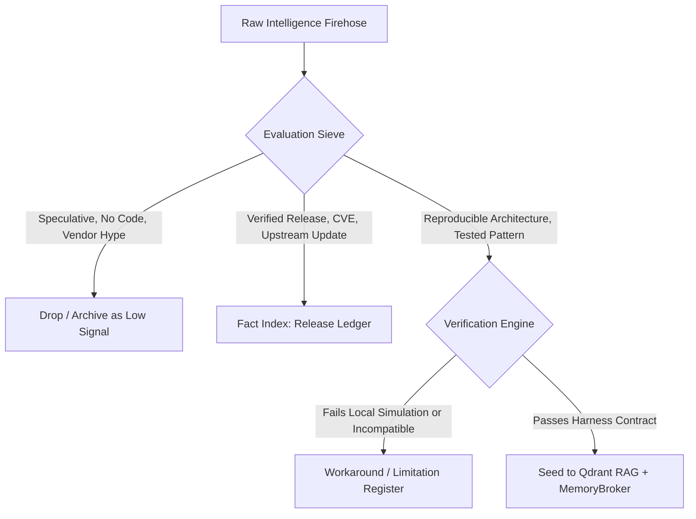

# SOTA Intelligence Sweeper: RAG Taxonomy, Topics & Verification Schema

## 1. Multi-Tier Knowledge Graph Taxonomy

To keep our institutional memory at the frontier without context poisoning or noise pollution, incoming intelligence is classified across 10 specialized RAG pillars and mapped to dedicated vector collections:

| Pillar | Focus & Frontier Scope | Primary Qdrant Collection | Retention & Freshness |
|---|---|---|---|
| **1. Agentic Architecture & Execution** | Durable agent loops, Effect Sandwiches, crash reconciliation, multi-agent hierarchies, System 1/2 streaming triage | `skills-patterns` | Persistent, high-weight semantic anchor |
| **2. Microarchitectural, Agentic & Systems Security** | Hardware isolation (`nosmt`, `isolcpus`), CPU cache timing covert-channel defense, agent-to-agent prompt injection mitigation, AppArmor profiles, seccomp/bwrap & Landlock containment | `best-practices` | Immutable security baseline |
| **3. Training, Fine-Tuning & Self-Improvement Loops** | Local model fine-tuning (QLoRA/Unsloth), continuous RLHF/DPO distillation, synthetic trajectory dataset generation, recursive self-improvement loops (RSI) | `mlops-patterns` | Experimental & iterative checkpoints |
| **4. New Model Capabilities & Frontier Benchmarks** | Emergent model capabilities (function calling, extended thinking tokens, multimodality), context window scaling, frontier benchmarks (SWE-bench, GAIA, HumanEval) | `knowledge` | Continually updated against frontier releases |
| **5. Memory & Context Engineering** | Hierarchical memory tiers (Episodic, Semantic, Procedural), lean-ctx token compression, dynamic AST pruning, BGE-M3 vector tuning | `agent-memory-semantic` & `codebase-context` | Dynamic, verified via test-retrieval |
| **6. Human-in-the-Loop & Cockpit UX** | Impeccable design patterns, stream-of-thought telemetry, one-click steering docks, visual blast-radius DAG overlays | `skills-patterns` & `wiki-sections` | Continual UI/UX improvement loop |
| **7. Operational Best Practices & Software Factory Patterns** | Production engineering conventions, zero-decorative-code enforcement, declarative NixOS deployment, automated change validation | `best-practices` | Authoritative operational guide |
| **8. Failure Modes & Auto-Remediation** | Live incident diagnosis, runtime workaround registers, flake evaluation errors, Python 3.13 reflection bugs | `error-solutions` | Deduplicated with exact trace matches |
| **9. Frontier Ecosystem & Tool Intake** | MCP 2026-07-28 conformance, REA reverse engineering, OSINT tools, benchmark scorecards | `mcp-semantic-search` & `knowledge` | Cadence-scanned, verified via intake gate |
| **10. Trading & Quantitative Intelligence** | Multi-agent financial market analysis, risk management, sentiment extraction, quantitative macroeconomic signals | `trading-patterns` | Real-time / high-cadence refresh |

---

## 2. Deep Intelligence Verification Contract (Hype vs. Fact vs. Signal)

Incoming material from YouTube (IndyDevDan, IBM Technology, TypeSafe Jev), arXiv papers, frontier lab technical reports (OpenAI, Anthropic, Google DeepMind), blogs, and open-source repos is subjected to a strict 3-tier validation sieve before vectorization:



### Classification Criteria:
1. **Hype (Score < 0.4)**: Marketing announcements, speculative capability claims, architectural discussions without code or reproducible benchmarks.
2. **Fact (Score 0.4 - 0.7)**: Package version bumps, CVE security disclosures, standard API reference updates, model parameter counts.
3. **Signal (Score > 0.7)**: Breakthrough design patterns, novel multi-agent interaction schemes, reproducible token reduction benchmarks, hardened security profiles, and validated fine-tuning methodologies.

---

## 3. Seed Record Schema

Every verified signal item seeded into AIDB / Qdrant must contain explicit provenance, category classification, and validation receipts:

```json
{
  "id": "uuid-v5",
  "pillar": "agentic-security",
  "title": "Microarchitectural CPU Cache Timing Covert-Channel Mitigation in Multi-Agent Runtimes",
  "source": {
    "author": "Google DeepMind Security Architecture",
    "channel": "arXiv / Frontier Systems Security",
    "trust_tier": "tier1-research"
  },
  "classification": {
    "tier": "SIGNAL",
    "confidence": 0.98,
    "receipt": "Verified via core pinning (AllowedCPUs=4-7), nosmt, and ephemeral container execution in scripts/ai/agent-driver.py"
  },
  "content": "Prevention of inter-agent covert data exfiltration via L1/L2/LLC timing probes using physical core stripping and hyperthreading disabling...",
  "applicable_subsystems": [
    "nix/modules/core/microarchitectural-isolation.nix",
    "scripts/ai/orchestrate-sandbox.sh",
    "scripts/ai/agent-driver.py"
  ],
  "bge_m3_embedding_status": "synced"
}
```
