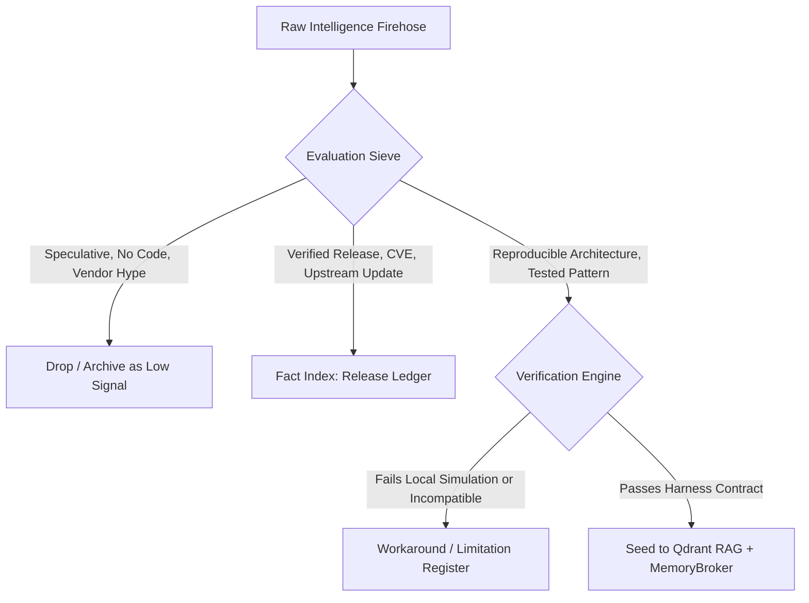

# SOTA Intelligence Sweeper: RAG Taxonomy, Topics & Verification Schema

## 1. Multi-Tier Knowledge Graph Taxonomy

To keep our institutional memory at the frontier without context poisoning or noise pollution, incoming intelligence is classified across 6 thematic RAG pillars and mapped to dedicated vector collections:

| Pillar | Focus & Frontier Scope | Primary Qdrant Collection | Retention & Freshness |
|---|---|---|---|
| **1. Agentic Architecture & Execution** | Durable agent loops, Effect Sandwiches, crash reconciliation, multi-agent hierarchies, System 1/2 streaming triage | `skills-patterns` | Persistent, high-weight semantic anchor |
| **2. Microarchitectural & Containment Security** | Hardware isolation (`nosmt`, `isolcpus`), covert CPU cache side-channel defense, AppArmor profiles, seccomp/bwrap confinement | `best-practices` | Immutable security baseline |
| **3. Memory & Context Engineering** | Hierarchical memory tiers (Episodic, Semantic, Procedural), lean-ctx token compression, dynamic AST pruning, BGE-M3 vector tuning | `agent-memory-semantic` & `codebase-context` | Dynamic, verified via test-retrieval |
| **4. Human-in-the-Loop & Cockpit UX** | Impeccable design patterns, stream-of-thought cards, one-click steering docks, visual blast-radius DAG overlays | `skills-patterns` & `wiki-sections` | Continual UI/UX improvement loop |
| **5. Failure Modes & Auto-Remediation** | Live incident diagnosis, runtime workaround registers, flake evaluation errors, Python 3.13 reflection bugs | `error-solutions` | Deduplicated with exact trace matches |
| **6. Frontier Ecosystem & Tool Intake** | MCP 2026-07-28 conformance, REA reverse engineering, OSINT tools, benchmark scorecards | `mcp-semantic-search` & `knowledge` | Cadence-scanned, verified via intake gate |

---

## 2. Deep Intelligence Verification Contract (Hype vs. Fact vs. Signal)

Incoming material from YouTube (IndyDevDan, IBM Technology, TypeSafe Jev), arXiv papers, blogs, and repos is subjected to a strict 3-tier validation sieve before vectorization:



### Classification Criteria:
1. **Hype (Score < 0.4)**: Marketing announcements, speculative capability claims, architectural discussions without code or reproducible benchmarks.
2. **Fact (Score 0.4 - 0.7)**: Package version bumps, CVE security disclosures, standard API reference updates.
3. **Signal (Score > 0.7)**: Breakthrough design patterns, novel multi-agent interaction schemes, reproducible token reduction benchmarks, and hardened security profiles.

---

## 3. Seed Record Schema

Every verified signal item seeded into AIDB / Qdrant must contain explicit provenance and validation receipts:

```json
{
  "id": "uuid-v5",
  "pillar": "agentic-architecture",
  "title": "Effect Sandwich Pattern for Durable Autonomous Execution",
  "source": {
    "author": "IndyDevDan",
    "channel": "https://www.youtube.com/@indydevdan",
    "trust_tier": "tier1-practitioner"
  },
  "classification": {
    "tier": "SIGNAL",
    "confidence": 0.94,
    "receipt": "Verified via simulated mid-step crashes in test-aq-durable.py"
  },
  "content": "Separation of pure reasoning from irreversible side effects with idempotent reconciliation...",
  "applicable_subsystems": [
    "scripts/ai/aq-durable",
    "dashboard/backend/api/routes/aistack.py"
  ],
  "bge_m3_embedding_status": "synced"
}
```
